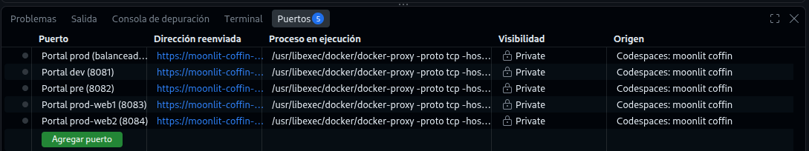
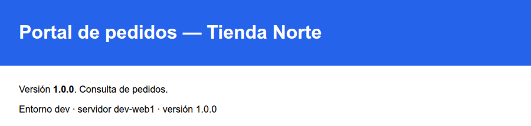

# Lab — Instalar y configurar un servicio

[← Página anterior](01-lab-modulos-principales.md) · [Siguiente página →](03-lab-ejecucion-idempotente.md)

El corazón del runbook de Tienda Norte es poner en marcha el portal en un servidor web: instalar nginx, colocar la
configuración del sitio, publicar la release `1.0.0` en `/srv/portal/releases/1.0.0` con el enlace
`/srv/portal/current`, dejar el `estado.json` del nodo y arrancar nginx. En este lab escribes `portal.yml` tarea
a tarea, ejecutándolo después de cada bloque, hasta que sirve el portal en dev y en los dos web de prod.

### Objetivo

Un `proyecto/portal.yml` que deja el portal respondiendo en `localhost:8081` (dev), `8083` y `8084` (prod), y que
en una segunda ejecución no cambia nada.

### Punto de partida

- Terminal del Codespace, en `proyecto/`.
- Estado: inventarios por entorno (`inventories/{dev,pre,prod}/hosts.yml`, con `portal_entorno` en cada uno) y la
  release del portal en `app/releases/1.0.0/index.html`. Nodos recién creados, **sin nginx**. El paso 1 te deja ahí.

### En qué consiste

Sigues el patrón **paquete → configuración → servicio**: diez tareas en un play sobre el grupo `web`. Los valores
(versión `1.0.0`, color) van fijos en el playbook; sacarlos a variables y plantillas es el M04.

### 1 — Carga el punto de partida con los nodos limpios

**Acción:**

```bash
# Terminal del Codespace, en la raíz del repo
cd "$CODESPACE_VSCODE_FOLDER"
scripts/partida.sh m03 --limpio
cd proyecto
```

**Por qué:** `--limpio` recrea los seis nodos sin nginx ni portal, aunque los hayas instalado en otro lab. Así ves
cada tarea cambiar la primera vez.

**Resultado esperado:** seis líneas `<nodo>  SSH ok` y `Listo: proyecto/ en el punto de partida «m03»`.

### 2 — Crea la configuración del sitio

**Acción:** crea `proyecto/files/portal.conf` con este contenido:

```nginx
server {
    listen 80 default_server;
    root /srv/portal/current;
    index index.html;
}
```

**Por qué:** es el fichero que el runbook copiaba con `scp`. Al servir siempre `/srv/portal/current`, cambiar de
release es mover un enlace, sin tocar nginx.

**Resultado esperado:** `cat files/portal.conf` muestra las cinco líneas del bloque `server`.

### 3 — Empieza el playbook por el paquete

**Acción:** crea `proyecto/portal.yml` con el play y la primera tarea, y ejecútalo:

```yaml
- name: Portal de pedidos en los servidores web
  hosts: web
  become: true
  tasks:
    - name: Instalar nginx
      ansible.builtin.apt:
        name: nginx
        state: present
        update_cache: true
        cache_valid_time: 3600
```

```bash
ansible-playbook portal.yml
curl -sS localhost:8081
```

**Por qué:** primero el paquete, porque todo lo demás (carpetas de nginx, servicio) depende de él.

**Resultado esperado:**

```text
TASK [Instalar nginx] **********************************************************
changed: [dev-web1]

PLAY RECAP *********************************************************************
dev-web1                   : ok=2    changed=1    unreachable=0    failed=0    skipped=0    rescued=0    ignored=0

curl: (56) Recv failure: Connection reset by peer
```

nginx está instalado pero **no responde**: en los nodos del curso un paquete no arranca su servicio al
instalarse. Lo arranca la tarea del paso 6.

### 4 — Añade la configuración del sitio

**Acción:** añade al final de `tasks:` estas tres tareas y ejecuta `ansible-playbook portal.yml`:

```yaml
    - name: Configurar el sitio del portal
      ansible.builtin.copy:
        src: files/portal.conf
        dest: /etc/nginx/sites-available/portal
        mode: "0644"
      register: portal_sitio_conf

    - name: Activar el sitio del portal
      ansible.builtin.file:
        src: /etc/nginx/sites-available/portal
        dest: /etc/nginx/sites-enabled/portal
        state: link

    - name: Quitar el sitio por defecto
      ansible.builtin.file:
        path: /etc/nginx/sites-enabled/default
        state: absent
```

**Por qué:** en Debian, nginx lee los sitios de `sites-enabled/`, que son enlaces a `sites-available/`. El sitio
`default` también escucha como `default_server` en el puerto 80: si se queda, nginx no arranca con los dos.
`register: portal_sitio_conf` guarda el resultado de la copia para usarlo en la última tarea.

**Resultado esperado:** `Instalar nginx` ya sale `ok`; las tres nuevas, `changed`:

```text
TASK [Instalar nginx] **********************************************************
ok: [dev-web1]

TASK [Configurar el sitio del portal] ******************************************
changed: [dev-web1]

TASK [Activar el sitio del portal] *********************************************
changed: [dev-web1]

TASK [Quitar el sitio por defecto] *********************************************
changed: [dev-web1]

PLAY RECAP *********************************************************************
dev-web1                   : ok=5    changed=3    unreachable=0    failed=0    skipped=0    rescued=0    ignored=0
```

Con `ssh -F ../infra/ssh_config dev-web1 ls -l /etc/nginx/sites-enabled` ves solo
`portal -> /etc/nginx/sites-available/portal`.

### 5 — Publica la release 1.0.0

**Acción:** añade estas cuatro tareas y ejecuta `ansible-playbook portal.yml`:

```yaml
    - name: Crear la carpeta de la release
      ansible.builtin.file:
        path: /srv/portal/releases/1.0.0
        state: directory
        mode: "0755"

    - name: Copiar la release 1.0.0
      ansible.builtin.copy:
        src: app/releases/1.0.0/
        dest: /srv/portal/releases/1.0.0/
        mode: "0644"

    - name: Apuntar current a la release 1.0.0
      ansible.builtin.file:
        src: /srv/portal/releases/1.0.0
        dest: /srv/portal/current
        state: link

    - name: Publicar el estado del nodo
      ansible.builtin.copy:
        dest: /srv/portal/releases/1.0.0/estado.json
        content: |
          {"host": "{{ inventory_hostname }}", "entorno": "{{ portal_entorno }}", "version": "1.0.0", "color": "#2563eb", "db": ""}
        mode: "0644"
```

**Por qué:** cada versión vive en su carpeta y `current` apunta a la activa: es lo que permitirá desplegar y
volver atrás en el M07. `estado.json` deja en cada nodo quién es y qué versión sirve, para comprobarlo con `curl`.
`inventory_hostname` y `portal_entorno` salen del inventario.

**Resultado esperado:** `ok=9 changed=4`, y en el nodo:

```text
$ ssh -F ../infra/ssh_config dev-web1 ls -l /srv/portal /srv/portal/current/
/srv/portal:
total 4
lrwxrwxrwx 1 root root   26 Oct 26 19:34 current -> /srv/portal/releases/1.0.0
drwxr-xr-x 3 root root 4096 Oct 26 19:34 releases

/srv/portal/current/:
total 8
-rw-r--r-- 1 root root  89 Oct 26 19:34 estado.json
-rw-r--r-- 1 root root 706 Oct 26 19:34 index.html
```

> [!TIP]
> La barra final de `src: app/releases/1.0.0/` importa: con barra, `copy` copia el **contenido** de la carpeta;
> sin ella, copiaría la carpeta y acabarías con `/srv/portal/releases/1.0.0/1.0.0/`.

### 6 — Arranca nginx y recárgalo si cambia el sitio

**Acción:** añade las dos últimas tareas y ejecuta:

```yaml
    - name: Arrancar nginx
      ansible.builtin.service:
        name: nginx
        state: started

    - name: Recargar nginx si ha cambiado el sitio
      ansible.builtin.service:
        name: nginx
        state: reloaded
      when: portal_sitio_conf is changed
```

```bash
ansible-playbook portal.yml
curl -s localhost:8081/estado.json
curl -s localhost:8081 | grep -i title
```

**Por qué:** `started` arranca nginx solo si está parado. Si nginx ya corría y cambia `portal.conf`, hay que
recargarlo para que lea la configuración nueva: la condición `when` usa el resultado guardado con `register`. En
el M06 esto se hace con un **handler**, la forma estándar; aquí ves el mecanismo a la vista.

**Resultado esperado:**

```text
TASK [Arrancar nginx] **********************************************************
changed: [dev-web1]

TASK [Recargar nginx si ha cambiado el sitio] **********************************
skipping: [dev-web1]

PLAY RECAP *********************************************************************
dev-web1                   : ok=10   changed=1    unreachable=0    failed=0    skipped=1    rescued=0    ignored=0

{"host": "dev-web1", "entorno": "dev", "version": "1.0.0", "color": "#2563eb", "db": ""}
<head><meta charset="utf-8"><title>Portal de pedidos — Tienda Norte</title>
```

La recarga sale `skipping`: el sitio cambió en la ejecución del paso 4, no en esta, y `register` solo ve lo que
pasa en la ejecución en curso. En la pestaña **Puertos** del Codespace, el puerto 8081 abre el portal de dev.



Al abrir la dirección reenviada del 8081 (el icono del globo al pasar por encima), el navegador muestra el portal
de dev en la 1.0.0:



### 7 — Comprueba que la recarga funciona

**Acción:** añade la línea `add_header X-Portal tienda-norte;` dentro del bloque `server` de `files/portal.conf`,
ejecuta y pide las cabeceras:

```bash
ansible-playbook portal.yml
curl -sI localhost:8081
```

**Por qué:** es el caso para el que existe la última tarea: cambia la configuración con nginx en marcha.

**Resultado esperado:** cambian la copia del sitio y la recarga, y la cabecera nueva aparece:

```text
TASK [Configurar el sitio del portal] ******************************************
changed: [dev-web1]
…
TASK [Recargar nginx si ha cambiado el sitio] **********************************
changed: [dev-web1]

PLAY RECAP *********************************************************************
dev-web1                   : ok=11   changed=2    unreachable=0    failed=0    skipped=0    rescued=0    ignored=0

HTTP/1.1 200 OK
Server: nginx
…
X-Portal: tienda-norte
Accept-Ranges: bytes
```

Quita la línea `add_header` y ejecuta otra vez: `changed=2` de nuevo y `curl -sI localhost:8081` ya no muestra
`X-Portal`.

### 8 — Compara con el playbook de referencia

**Acción:** `diff portal.yml ../partidas/m04/portal.yml && diff files/portal.conf ../partidas/m04/files/portal.conf && echo iguales`

**Por qué:** `partidas/m04/` es el punto de partida del módulo siguiente. Si tu playbook coincide, todo lo que
venga después encaja con él.

**Resultado esperado:** `iguales`. Si `diff` muestra líneas, son diferencias de nombres o de indentación: corrígelas.

### 9 — Aplícalo a los web de prod

**Acción:**

```bash
ansible-playbook -i inventories/prod/hosts.yml portal.yml
curl -s localhost:8083/estado.json
curl -s localhost:8084/estado.json
```

**Por qué:** el mismo playbook, otro inventario. En prod el grupo `web` tiene dos nodos y Ansible los trata a la
vez.

**Resultado esperado:**

```text
PLAY RECAP *********************************************************************
prod-web1                  : ok=11   changed=10   unreachable=0    failed=0    skipped=0    rescued=0    ignored=0
prod-web2                  : ok=11   changed=10   unreachable=0    failed=0    skipped=0    rescued=0    ignored=0

{"host": "prod-web1", "entorno": "prod", "version": "1.0.0", "color": "#2563eb", "db": ""}
{"host": "prod-web2", "entorno": "prod", "version": "1.0.0", "color": "#2563eb", "db": ""}
```

En la primera ejecución sobre un nodo limpio también cambia la recarga: el sitio cambia en esta misma ejecución.
El `entorno` sale bien (`prod`, del inventario), pero el color es el de dev: está fijo en el playbook. Lo
arreglan las variables por entorno del M04. El balanceador (`localhost:8080`) aún no está configurado.

## Comprueba tu entendimiento

**Segunda ejecución**
Ejecuta `ansible-playbook portal.yml`.
→ `ok=10 changed=0 skipped=1`: la recarga se salta porque el sitio no ha cambiado.

**Cada nodo dice quién es**
Ejecuta `curl -s localhost:8084/estado.json`.
→ `"host": "prod-web2"` y `"entorno": "prod"`.

**Orden del patrón**
Ejecuta `ansible-playbook portal.yml --list-tasks`.
→ Diez tareas en orden: `Instalar nginx` la primera, `Recargar nginx si ha cambiado el sitio` la última.

## Reto

### 1 — Pre también

Deja el portal en `pre-web1` y comprueba su `estado.json` en el puerto 8082.

<details>
<summary>Ver solución</summary>

```bash
ansible-playbook -i inventories/pre/hosts.yml portal.yml
curl -s localhost:8082/estado.json
```

El resumen de `pre-web1` es `ok=11 changed=10` y el JSON dice `"host": "pre-web1", "entorno": "pre"`.

</details>

### 2 — ¿Y si falta el fichero?

Renombra `files/portal.conf` a `files/portal.conf.bak`, ejecuta `ansible-playbook portal.yml` y explica qué
tareas se han aplicado. Después devuélvelo a su nombre.

<details>
<summary>Ver solución</summary>

Falla `Configurar el sitio del portal`:

```text
[ERROR]: Task failed: Unexpected AnsibleActionFail error: Could not find or access 'files/portal.conf'
Searched in:
	/workspaces/ansible-automatizacion-201/proyecto/files/files/portal.conf
	/workspaces/ansible-automatizacion-201/proyecto/files/portal.conf
…
```

`Instalar nginx` se ejecutó (`ok`) y el resto del play no, solo en ese nodo. `src` se busca en el Codespace
(junto al playbook y en `files/`), no en el nodo. Con `mv files/portal.conf.bak files/portal.conf` vuelve a ir.

</details>

## Errores frecuentes

| Síntoma | Causa probable | Cómo arreglarlo |
|---------|----------------|-----------------|
| `curl: (56) Recv failure: Connection reset by peer` en 8081 | nginx instalado pero parado | Falta la tarea `Arrancar nginx` (`state: started`) |
| `Could not find or access 'files/portal.conf'` | Fichero ausente o `ansible-playbook` lanzado fuera de `proyecto/` | `cd proyecto` y comprueba `ls files/` |
| `403 Forbidden` al pedir el portal | `current` no apunta a una release con `index.html` | Revisa la tarea `Apuntar current…` y `ls /srv/portal/current/` |
| Sale la página «Welcome to nginx!» | Sigue activo el sitio `default` | Tarea `Quitar el sitio por defecto` |
| Aparece `/srv/portal/releases/1.0.0/1.0.0/` | Falta la barra final en `src: app/releases/1.0.0/` | Pon la barra y borra la carpeta sobrante |
| Cambias `portal.conf` y nginx sirve lo anterior | La recarga no se ejecutó | Comprueba `register: portal_sitio_conf` en la copia y el `when` de la recarga |
