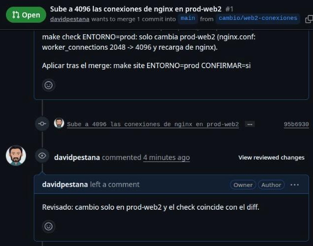

# Lab — Cambios con PR

[← Página anterior](03-lab-validacion-previa.md) · [Siguiente página →](../M11-control-centralizado/README.md)

En Tienda Norte nadie cambia prod desde su terminal sin que otra persona lo haya visto: cada cambio del portal
pasa por una rama, un pull request con la simulación adjunta, una revisión y el merge a `main`. Solo lo que está en
`main` se aplica. En este lab llevas un cambio real del proyecto, las conexiones de nginx de `prod-web2`, por ese
camino en tu fork de GitHub y después localizas quién lo hizo, cuándo y por qué.

### Objetivo

Un pull request en tu fork, revisado y fusionado en `main`, con el cambio de `prod-web2` aplicado en prod desde
`main` y localizable con `git log` y `git blame`.

### Punto de partida

- Terminal del Codespace de **tu fork**, en la raíz del repositorio. `gh` ya está autenticado en Codespaces
  (compruébalo con `gh auth status`).
- Estado: proyecto completo con `Makefile` y `.ansible-lint` y prod con el portal aplicado. Lo deja así el paso 1.
- El proyecto vive en `proyecto/` de tu fork: lo que cambias ahí es lo que versionas.

### En qué consiste

Trabajas en Git y GitHub: rama, commit, push, pull request, revisión, merge y lectura del historial. La única
ejecución sobre los nodos es la validación previa y la aplicación final desde `main`, ambas con `make`.

### 1 — Guarda tu trabajo y carga el punto de partida

**Acción:**

```bash
# Terminal del Codespace, en la raíz del repositorio
cd "$CODESPACE_VSCODE_FOLDER"
git status
```

Si `git status` muestra cambios tuyos que quieres conservar, haz commit antes (`git add -A && git commit -m "…"`).
Después:

```bash
# Terminal del Codespace, en la raíz del repositorio
scripts/partida.sh m11
git add proyecto
git commit -m "Proyecto en el punto de partida m11"
git push origin main
```

**Por qué:** `scripts/partida.sh` **sustituye** `proyecto/` entero; lo que no esté en un commit solo queda en
`proyecto.anterior/` hasta la próxima vez. El commit sobre `main` deja una base limpia para que el pull request
contenga solo tu cambio.

**Resultado esperado:** `git status` dice `nothing to commit, working tree clean` y `Your branch is up to date with
'origin/main'.`

> [!NOTE]
> Si `git commit` responde `nothing to commit`, tu `proyecto/` ya estaba igual que el punto de partida: sigue al
> paso 2.

### 2 — Haz que `gh` trabaje sobre tu fork

**Acción:**

```bash
# Terminal del Codespace, en la raíz del repositorio
gh repo set-default "$GITHUB_REPOSITORY"
gh repo set-default --view
```

**Por qué:** en un fork, `gh pr create` propone por defecto abrir el pull request contra el repositorio original
del curso. `GITHUB_REPOSITORY` es la variable del Codespace con `<tu-usuario>/<tu-fork>`: con ella, los pull
requests se abren y se fusionan dentro de tu fork.

**Resultado esperado:** `gh repo set-default --view` muestra `<tu-usuario>/<tu-fork>`.

### 3 — Crea la rama del cambio

**Acción:**

```bash
# Terminal del Codespace, en la raíz del repositorio
git switch -c cambio/web2-conexiones
```

**Por qué:** el cambio se prepara fuera de `main`. Mientras no se fusiona, `main` sigue siendo lo que está aplicado
en prod.

**Resultado esperado:**

```text
Switched to a new branch 'cambio/web2-conexiones'
```

### 4 — Cambia `prod-web2` y mira el diff

**Acción:** en `proyecto/inventories/prod/host_vars/prod-web2.yml`, cambia `2048` por `4096`. Después:

```bash
# Terminal del Codespace, en la raíz del repositorio
git diff
```

**Por qué:** `git diff` es lo mismo que verá quien revise: confirma que solo cambia lo que querías.

**Resultado esperado:**

```text
diff --git a/proyecto/inventories/prod/host_vars/prod-web2.yml b/proyecto/inventories/prod/host_vars/prod-web2.yml
index fa9494a..dbd30a7 100644
--- a/proyecto/inventories/prod/host_vars/prod-web2.yml
+++ b/proyecto/inventories/prod/host_vars/prod-web2.yml
@@ -1 +1 @@
-portal_worker_connections: 2048
+portal_worker_connections: 4096
```

### 5 — Valida y simula antes de proponer

**Acción:**

```bash
# Terminal del Codespace, en proyecto/
cd proyecto
make validar ENTORNO=prod
make check ENTORNO=prod
cd ..
```

**Por qué:** un pull request que no pasa el lint hace perder el tiempo a quien revisa. La salida del check es la
prueba de qué va a cambiar en prod: la pegarás en el pull request.

**Resultado esperado:** `make validar` termina con `Profile 'production' was required, and it passed.` y
`playbook: deploy.yml`. En `make check`, solo `prod-web2` sale con cambios, con este diff:

```text
-    worker_connections 2048;
+    worker_connections 4096;
```

```text
prod-web2                  : ok=12   changed=2    unreachable=0    failed=0    skipped=0    rescued=0    ignored=0
```

### 6 — Haz el commit con el motivo

**Acción:**

```bash
# Terminal del Codespace, en la raíz del repositorio
git add proyecto/inventories/prod/host_vars/prod-web2.yml
git commit -m "Sube a 4096 las conexiones de nginx en prod-web2" \
  -m "prod-web2 atiende más tráfico en campaña; prod-web1 sigue en 768."
```

**Por qué:** la primera línea dice **qué** cambia; el segundo `-m` añade el **porqué**, que es lo que nadie
recordará dentro de unos meses. Así queda en el historial junto al cambio.

**Resultado esperado:**

```text
[cambio/web2-conexiones 1c7ec5e] Sube a 4096 las conexiones de nginx en prod-web2
 1 file changed, 1 insertion(+), 1 deletion(-)
```

Tu identificador (`1c7ec5e`) será otro.

### 7 — Sube la rama a tu fork

**Acción:**

```bash
# Terminal del Codespace, en la raíz del repositorio
git push -u origin cambio/web2-conexiones
```

**Por qué:** el pull request se abre sobre una rama que ya está en GitHub. `-u` deja la rama local enlazada con la
remota para los siguientes `git push`.

**Resultado esperado:** al final de la salida:

```text
 * [new branch]      cambio/web2-conexiones -> cambio/web2-conexiones
branch 'cambio/web2-conexiones' set up to track 'origin/cambio/web2-conexiones'.
```

GitHub añade antes unas líneas `remote:` con el enlace para crear el pull request desde el navegador.

### 8 — Abre el pull request

**Acción:**

```bash
# Terminal del Codespace, en la raíz del repositorio
gh pr create --base main --head cambio/web2-conexiones \
  --title "Sube a 4096 las conexiones de nginx en prod-web2" \
  --body "Motivo: prod-web2 atiende más tráfico en campaña.

Validación: make validar ENTORNO=prod pasa (perfil production).
make check ENTORNO=prod: solo cambia prod-web2 (nginx.conf: worker_connections 2048 -> 4096 y recarga de nginx).

Aplicar tras el merge: make site ENTORNO=prod CONFIRMAR=si"
```

**Por qué:** el pull request es la petición formal de cambio: qué, por qué, cómo se ha validado y cómo se aplica.
Quien revisa no tiene que adivinar nada ni repetir la simulación para entenderlo.

**Resultado esperado:** `gh` responde con la URL del pull request, del tipo
`https://github.com/<tu-usuario>/<tu-fork>/pull/1`. Ábrela con `gh pr view --web`: en **Files changed** aparece
solo `prod-web2.yml`.

### 9 — Revisa el pull request

**Acción:**

```bash
# Terminal del Codespace, en la raíz del repositorio
gh pr view
gh pr diff
gh pr review --comment --body "Revisado: cambio solo en prod-web2 y el check coincide con el diff."
```

**Por qué:** en un equipo, la revisión la hace otra persona; aquí haces tú los dos papeles. `gh pr view` enseña el
título, el cuerpo y el estado; `gh pr diff`, el cambio exacto; `gh pr review` deja la revisión registrada en el
pull request.

**Resultado esperado:** `gh pr view` muestra el título, `Open` y tu descripción; `gh pr diff` repite el diff del
paso 4; tras `gh pr review`, la pestaña **Conversation** del pull request muestra tu comentario de revisión.



> [!NOTE]
> GitHub no deja **aprobar** (`gh pr review --approve`) un pull request propio: por eso aquí la revisión es un
> comentario. En el repositorio del equipo, una regla de protección de `main` exigiría la aprobación de otra
> persona antes del merge.

### 10 — Fusiona en `main`

**Acción:**

```bash
# Terminal del Codespace, en la raíz del repositorio
gh pr merge --merge --delete-branch
git switch main
git pull
```

**Por qué:** `--merge` crea un commit de merge cuyo mensaje lleva el número del pull request: desde el historial
se llega a la revisión. `--delete-branch` borra la rama, en GitHub y en tu Codespace, que ya no hace falta.
`git switch main` y `git pull` dejan tu Codespace en el `main` de GitHub.

**Resultado esperado:** `gh` confirma el merge y el borrado de la rama. Como al borrar la rama local `gh` ya te
pasa a `main` y trae el merge, `git switch main` responde `Already on 'main'` y `git pull`, `Already up to date.`
`cat proyecto/inventories/prod/host_vars/prod-web2.yml` muestra `portal_worker_connections: 4096`.

### 11 — Sigue la traza del cambio

**Acción:**

```bash
# Terminal del Codespace, en la raíz del repositorio
git log --oneline --graph -4
git blame proyecto/inventories/prod/host_vars/prod-web2.yml
```

**Por qué:** es la pregunta que llega meses después: «¿quién puso 4096 en `prod-web2`, cuándo y por qué?». El
`blame` da el commit de cada línea; el `log`, el merge con el número del pull request donde está la revisión.

**Resultado esperado** (identificadores, nombre y fechas serán los tuyos):

```text
*   0c0ed44 Merge pull request #1 from <tu-usuario>/cambio/web2-conexiones
|\
| * 1c7ec5e Sube a 4096 las conexiones de nginx en prod-web2
|/
* e9e9804 Proyecto en el punto de partida m11
```

```text
1c7ec5ee (Tu Nombre 2026-10-27 00:45:58 +0100 1) portal_worker_connections: 4096
```

Con `git show 1c7ec5e` ves el mensaje completo, con el motivo, y `gh pr view 1` abre la revisión.

### 12 — Aplica en prod desde `main`

**Acción:**

```bash
# Terminal del Codespace, en proyecto/
cd proyecto
make site ENTORNO=prod CONFIRMAR=si
docker exec prod-web2 grep worker_connections /etc/nginx/nginx.conf
```

**Por qué:** en prod se aplica lo que está en `main`, ni más ni menos. Si alguien pregunta qué hay en prod, la
respuesta es el último commit de `main`.

**Resultado esperado:** el resumen con `prod-web2 … changed=2` y el resto en `changed=0`, y en el nodo
`worker_connections 4096;`.

## Comprueba tu entendimiento

**Qué hay en `main`**
`git log --oneline -1 origin/main`.
→ El commit `Merge pull request #1 from …`: lo último fusionado, que es lo que está aplicado en prod.

**Quién tocó un fichero**
`git log --format='%h %an %ad %s' -- proyecto/inventories/prod/host_vars/prod-web2.yml`.
→ Tu commit `Sube a 4096 las conexiones de nginx en prod-web2` con tu nombre y la fecha, y debajo el commit del
punto de partida.

**El pull request como registro**
`gh pr list --state merged`.
→ Tu pull request #1 aparece como fusionado; `gh pr view 1 --comments` muestra la revisión.

## Reto

### 1 — Un cambio que se rechaza

Crea la rama `cambio/web1-conexiones`, pon `portal_worker_connections: 100` en un nuevo
`proyecto/inventories/prod/host_vars/prod-web1.yml`, ábrelo como pull request y, en la revisión, pide cambios y
ciérralo sin fusionar.

<details>
<summary>Ver solución</summary>

```bash
# Terminal del Codespace, en la raíz del repositorio
git switch -c cambio/web1-conexiones
echo "portal_worker_connections: 100" > proyecto/inventories/prod/host_vars/prod-web1.yml
git add proyecto/inventories/prod/host_vars/prod-web1.yml
git commit -m "Baja a 100 las conexiones de nginx en prod-web1"
git push -u origin cambio/web1-conexiones
gh pr create --base main --fill
gh pr comment --body "100 conexiones es muy poco para prod; no lo fusionamos."
gh pr close --delete-branch
git switch main
```

El pull request queda como **Closed**, con el comentario como registro de por qué se rechazó, y `main` (y prod)
no cambia. `gh pr list --state closed` lo muestra.

</details>

### 2 — ¿Por qué no aplicar desde la rama?

Antes del merge, `make site ENTORNO=prod CONFIRMAR=si` desde la rama `cambio/web2-conexiones` también funciona.
Explica por qué el equipo no lo hace.

<details>
<summary>Ver solución</summary>

Porque prod dejaría de coincidir con `main`: si el pull request se rechaza o cambia en la revisión, prod tiene algo
que no está en ningún sitio revisado, y el siguiente `make site` desde `main` lo desharía sin avisar. La regla
«solo se aplica lo que está en `main`» es la que hace que `git log` sea la historia real de prod.

</details>

## Errores frecuentes

| Síntoma | Causa probable | Cómo arreglarlo |
|---------|----------------|-----------------|
| `gh pr create` propone el repositorio original del curso o pregunta dónde abrir el PR | Falta el repositorio por defecto en un fork | `gh repo set-default "$GITHUB_REPOSITORY"` |
| Tu trabajo de `proyecto/` ha desaparecido tras `partida.sh` | `partida.sh` sustituye `proyecto/` | Recupéralo de `proyecto.anterior/` antes de volver a cargar otra partida, y haz commit antes la próxima vez |
| El pull request incluye muchos ficheros además de `prod-web2.yml` | No hiciste el commit del punto de partida en `main` antes de crear la rama | Haz ese commit en `main`, y en la rama `git rebase main`, o crea la rama de nuevo |
| `gh pr review --approve` falla con `Can not approve your own pull request` | GitHub no deja aprobar un pull request propio | Usa `gh pr review --comment` |
| `git push` responde `rejected … (fetch first)` | `main` de GitHub tiene commits que tu Codespace no tiene | `git pull` y repite el `git push` |
