# El portal desde AWX

[← Página anterior](00-awx-y-aap.md) · [Siguiente página →](02-cicd-como-alternativa.md)

Operaciones de Tienda Norte quiere que el despliegue de prod deje de depender de quién tiene la clave SSH
en su Codespace. En esta demostración, el mismo `proyecto/deploy.yml` que se lanza con `make deploy` pasa a
lanzarse desde AWX.

## Qué se va a ver

**Qué se hace**

1. Se da de alta el fork como proyecto de AWX dentro de la organización Tienda Norte.
2. Se guarda la clave del usuario `ansible` como credencial Machine, por la API y sin mostrarla.
3. Se sincroniza el inventario de prod desde `proyecto/inventories/prod/hosts.yml`.
4. Se crea la plantilla «Desplegar portal» con una encuesta de versión y se lanza con la 1.1.0 y con la 1.2.0.
5. Se da a un equipo de guardia permiso para lanzar la plantilla, pero no para cambiarla.
6. Se revisan los jobs y el Activity Stream para saber quién lanzó y quién cambió qué.

**Objetivos**

- Reconocer en AWX el proyecto del curso: proyecto, inventario, credencial y plantilla.
- Leer la salida de un job y su detalle: versión pedida, commit ejecutado y quién lo lanzó.
- Ver cómo se reparte el permiso de lanzar sin dar el de editar ni el de ver la clave.

**Conclusiones**

- El playbook no cambia: rollback, `serial` y verificación siguen siendo cosa de `deploy.yml`.
- La clave queda cifrada en AWX y nadie la vuelve a ver, ni por la interfaz ni por la API.
- Cada ejecución y cada cambio de configuración queda registrado con su usuario.

## Punto de partida

- **Un Codespace aparte para AWX.** El Codespace normal del curso (2 núcleos, 8 GB) no tiene kind ni
  memoria para AWX. La demo se hace en otro Codespace del mismo fork, creado con la configuración
  **Ansible — Tienda Norte + AWX (demo M11)** (`.devcontainer/awx/`: 4 núcleos, 16 GB, kind y kubectl). En
  GitHub, en el fork: **Code** → **Codespaces** → **…** → **New with options…** → en **Dev container
  configuration**, esa configuración → **Create codespace**. Al arrancar levanta los mismos seis nodos y
  crea su propia clave en `~/.ssh/curso-ansible/curso_ansible`; todo lo que sigue se hace en ese Codespace.
  Detalles en [El entorno del curso](../../infra/README.md).
- **El fork es público**: AWX lo clona de GitHub sin credencial de Git.
- **Nodos de prod con el portal instalado y `proyecto/` en el estado del M11** (roles, `site.yml`,
  `deploy.yml`, `Makefile`). Desde la raíz del repo:

  ```bash
  # Terminal del Codespace, en la raíz del repo
  cd "$CODESPACE_VSCODE_FOLDER"
  scripts/partida.sh m11
  ```

  ```text
  Preparando los nodos para m11…
  PLAY RECAP *********************************************************************
  prod-db1                   : ok=9    changed=7    unreachable=0    failed=0    skipped=0    rescued=0    ignored=0
  prod-lb1                   : ok=5    changed=4    unreachable=0    failed=0    skipped=0    rescued=0    ignored=0
  prod-web1                  : ok=12   changed=11   unreachable=0    failed=0    skipped=0    rescued=0    ignored=0
  prod-web2                  : ok=12   changed=11   unreachable=0    failed=0    skipped=0    rescued=0    ignored=0

  Listo: proyecto/ en el punto de partida «m11» (lo anterior está en proyecto.anterior/).
  ```

- **Ese `proyecto/` subido a la rama `main` del fork**, porque AWX no lee el Codespace sino GitHub:

  ```bash
  # Terminal del Codespace, en la raíz del repo
  git add proyecto
  git commit -m "Proyecto del portal en el estado del M11"
  git push
  gh repo view --json url -q .url
  ```

  La última línea imprime la URL del fork (`https://github.com/<tu-usuario>/<repo>`), que es la que se
  usa en el proyecto de AWX. Si `git commit` dice `nothing to commit`, `main` ya tenía ese estado.

  > [!NOTE]
  > Si `main` quedó protegida en el M10 y no admite `push` directo, el cambio entra por pull request, o se
  > sube a otra rama (`git push origin HEAD:awx-demo`) y esa rama es la que se indica en el proyecto.

- **AWX levantado** con el script del curso (kind + AWX Operator 2.19.1 + AWX 24.6.1). Tarda varios
  minutos la primera vez, mientras descarga las imágenes:

  ```bash
  # Terminal del Codespace, en la raíz del repo
  scripts/awx-up.sh
  ```

  Termina con `AWX listo: http://localhost:8043`, el usuario `admin` y su contraseña. Si los nodos ya están
  en marcha, el script no los toca, así que el estado que dejó `partida.sh m11` se conserva. La contraseña se
  puede volver a consultar en cualquier momento:

  ```bash
  kubectl -n awx get secret awx-admin-password -o jsonpath='{.data.password}' | base64 -d; echo
  ```

- **URL**: pestaña **Puertos** del Codespace → puerto **8043** → icono del globo (abrir en el navegador).
- **Identidad**: `admin` con la contraseña anterior.

## Recorrido

### 1 — La entrada en AWX

Tras iniciar sesión como `admin`, AWX abre el **Dashboard**: contadores de hosts, proyectos e inventarios y
un gráfico de jobs. No empiezan en cero: AWX trae de ejemplo `Demo Project`, `Demo Inventory` (con
`localhost`) y `Demo Job Template`, que la demo no usa. El menú lateral agrupa lo que se usa en la demo:

| Sección del menú | Entradas | Para qué en la demo |
|------------------|----------|---------------------|
| **Views** | Dashboard, Jobs, Schedules, Activity Stream | Ver los jobs y la auditoría |
| **Resources** | Templates, Credentials, Projects, Inventories, Hosts | Lo que hace falta para ejecutar `deploy.yml` |
| **Access** | Organizations, Users, Teams | Quién puede hacer qué |
| **Administration** | Execution Environments, Instance Groups, … | La imagen en la que corre cada job |

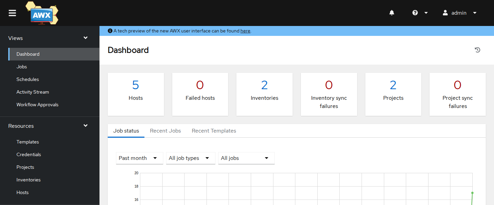

> [!NOTE]
> La interfaz sale en el idioma del navegador. En español, las secciones son **Vistas** (Panel de control,
> Trabajos, Programaciones, Flujo de actividad), **Recursos** (Plantillas, Credenciales, Proyectos,
> Inventarios, Servidores), **Acceso** (Organizaciones, Usuarios, Equipos) y **Administración** (Entornos de
> ejecución, Grupos de instancias…). Los botones también cambian: **Add** es **Agregar** y **Save**,
> **Guardar**. Esta página usa los nombres en inglés.

### 2 — La organización Tienda Norte

En **Access → Organizations → Add** se crea la organización **Name** `Tienda Norte` y se guarda con
**Save**. AWX trae una organización `Default`; usar una propia separa los objetos del portal de cualquier
otra cosa que viva en el mismo AWX y permite dar a alguien la administración de Tienda Norte sin darle la
del sistema entero.

### 3 — El proyecto: el fork en GitHub

En **Resources → Projects → Add**:

| Campo | Valor |
|-------|-------|
| Name | `Portal Tienda Norte` |
| Organization | `Tienda Norte` |
| Source Control Type | `Git` |
| Source Control URL | la URL del fork que imprimió `gh repo view` |
| Source Control Branch/Tag/Commit | `main` |
| Options | **Update Revision on Launch** marcada |

**Source Control URL** y **Source Control Branch/Tag/Commit** aparecen al elegir `Git` como tipo. Al
guardar, AWX lanza la primera sincronización (un job de tipo *Source Control Update*). En la lista de
proyectos, el estado pasa a **Successful** y la columna **Revision** muestra el commit sincronizado:

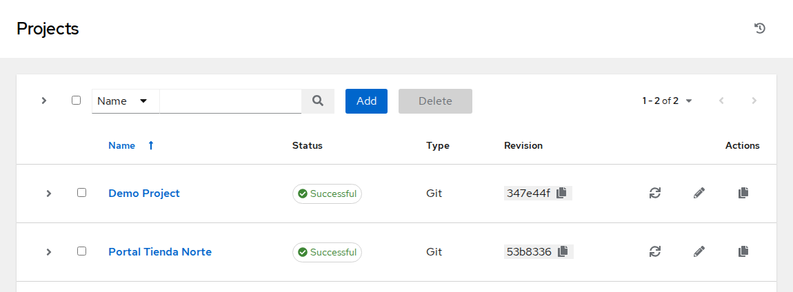

Desde ese
momento, AWX tiene su propia copia del repositorio; con **Update Revision on Launch**, cada job vuelve a
sincronizar antes de ejecutar, así que lo que se despliega es siempre lo último de `main`.

> [!NOTE]
> AWX ejecuta desde la raíz del repositorio clonado, no desde `proyecto/`. Por eso los playbooks se eligen
> como `proyecto/deploy.yml` y `proyecto/site.yml`, y por eso `proyecto/ansible.cfg` no se aplica: el
> usuario remoto y la clave llegan por la credencial del paso 4. Los roles sí se encuentran, porque
> `proyecto/roles/` está junto al playbook, y `{{ playbook_dir }}/app/releases/` apunta a donde debe.

### 4 — La credencial Machine: la clave sin enseñarla

La clave privada `~/.ssh/curso-ansible/curso_ansible` no debe aparecer en pantalla: si se abre en el editor
para copiarla en el formulario de AWX, queda a la vista de quien mire. En la demo se crea la credencial
por la **API** de AWX desde el terminal, leyendo el fichero sin mostrarlo. Es, además, la primera muestra de
que todo lo que hace la interfaz se puede automatizar.

```bash
# Terminal del Codespace
AWX=http://localhost:8043
PASS=$(kubectl -n awx get secret awx-admin-password -o jsonpath='{.data.password}' | base64 -d)
ORG=$(curl -s -u "admin:$PASS" "$AWX/api/v2/organizations/?name=Tienda%20Norte" \
      | python3 -c 'import json,sys; print(json.load(sys.stdin)["results"][0]["id"])')
TIPO=$(curl -s -u "admin:$PASS" "$AWX/api/v2/credential_types/?kind=ssh" \
      | python3 -c 'import json,sys; print(json.load(sys.stdin)["results"][0]["id"])')
python3 -c '
import json, sys
clave = open(sys.argv[2]).read()
print(json.dumps({"name": "Nodos del portal (ansible)", "organization": int(sys.argv[1]),
                  "credential_type": int(sys.argv[3]),
                  "inputs": {"username": "ansible", "ssh_key_data": clave, "become_method": "sudo"}}))
' "$ORG" ~/.ssh/curso-ansible/curso_ansible "$TIPO" \
  | curl -s -u "admin:$PASS" -H 'Content-Type: application/json' -d @- "$AWX/api/v2/credentials/" \
  | python3 -c 'import json,sys; c=json.load(sys.stdin); print(c["id"], c["name"], c["inputs"]["ssh_key_data"])'
```

```text
3 Nodos del portal (ansible) $encrypted$
```

La respuesta solo trae el identificador (el número puede variar), el nombre y `$encrypted$` en lugar de la
clave: AWX la guarda cifrada y no la devuelve nunca, ni por API ni por la interfaz.

En **Resources → Credentials** aparece `Nodos del portal (ansible)`, de tipo **Machine**. Su detalle
muestra **Username** `ansible`, **Privilege Escalation Method** `sudo` y el campo **SSH Private Key** como
`Encrypted`. Los playbooks ya llevan `become: true` y el usuario `ansible` tiene sudo sin contraseña, así que
no hace falta contraseña de escalada.

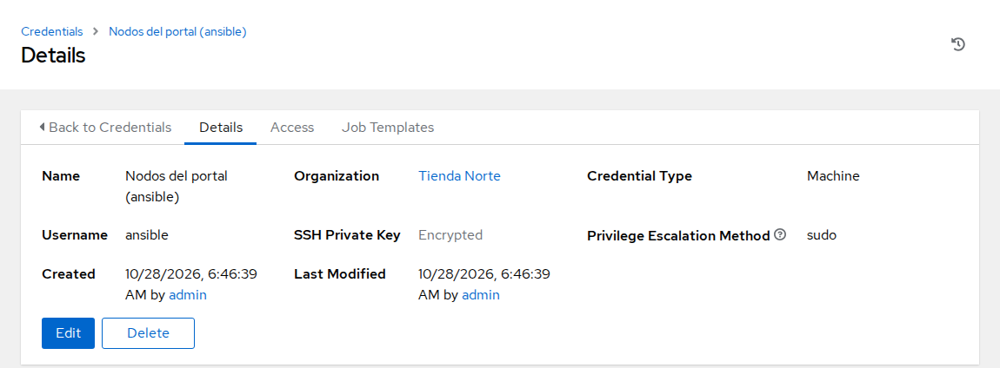

> [!TIP]
> Desde la interfaz, la misma credencial se crea en **Resources → Credentials → Add** con **Credential
> Type** `Machine`, rellenando **Username**, **SSH Private Key** y **Privilege Escalation Method**. Es el
> camino habitual cuando la clave está en el equipo de quien la da de alta y no hay nadie mirando.

### 5 — El inventario «Portal prod», desde el proyecto

En **Resources → Inventories → Add → Add inventory** se crea **Name** `Portal prod` en la organización
`Tienda Norte`. Un inventario recién creado está vacío; los hosts llegan por una fuente. En la pestaña
**Sources → Add**:

| Campo | Valor |
|-------|-------|
| Name | `hosts.yml de prod` |
| Source | `Sourced from a Project` |
| Project | `Portal Tienda Norte` |
| Inventory file | `proyecto/inventories/prod/hosts.yml` |
| Update options | **Overwrite** y **Update on launch** marcadas |

El desplegable de **Inventory file** no ofrece `proyecto/inventories/prod/hosts.yml`: AWX lo toma por un
playbook (tiene la clave `hosts`) y solo lista otros ficheros del repositorio. Se escribe la ruta en el campo
y se elige la opción **Set source path to "proyecto/inventories/prod/hosts.yml"**:

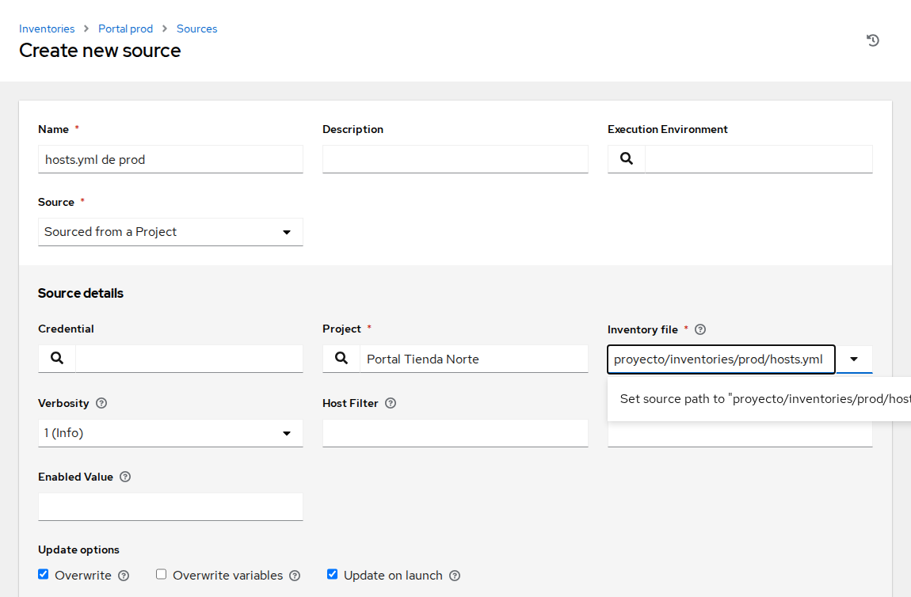

Al guardar y pulsar **Sync**, AWX ejecuta `ansible-inventory` sobre ese fichero. Es lo mismo que se ve en el
terminal con:

```bash
# Terminal del Codespace, en la raíz del repo
ansible-inventory -i proyecto/inventories/prod/hosts.yml --graph
```

```text
@all:
  |--@ungrouped:
  |--@web:
  |  |--prod-web1
  |  |--prod-web2
  |--@lb:
  |  |--prod-lb1
  |--@db:
  |  |--prod-db1
```

Tras la sincronización, la pestaña **Hosts** del inventario lista `prod-db1`, `prod-lb1`, `prod-web1` y
`prod-web2`, y **Groups** muestra `web`, `lb` y `db`:

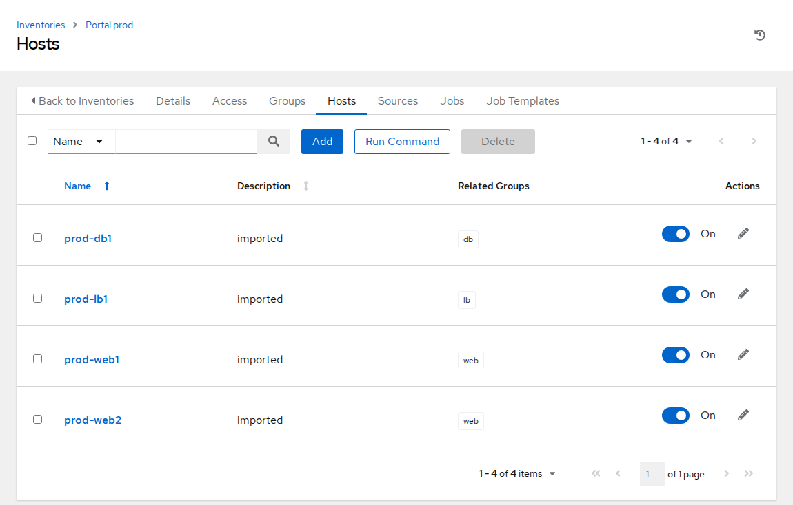

Las variables de `group_vars/all.yml`
(`portal_entorno: prod`, `portal_version: "1.0.0"`, `portal_color`, `portal_db_host`) quedan como variables
del inventario, y `host_vars/prod-web2.yml` como variables del host `prod-web2`:

```bash
# Terminal del Codespace, en la raíz del repo
ansible-inventory -i proyecto/inventories/prod/hosts.yml --host prod-web2
```

```text
{
    "portal_color": "#15803d",
    "portal_db_host": "prod-db1",
    "portal_entorno": "prod",
    "portal_version": "1.0.0",
    "portal_worker_connections": 2048
}
```

Este es el **inventario centralizado**: el `hosts.yml` sigue en Git y pasa por revisión, pero quien lanza no
necesita una copia; AWX lo sincroniza y todos ven los mismos cuatro hosts. **Resources → Hosts** reúne los
hosts de todos los inventarios en una sola lista.

> [!NOTE]
> Los nombres `prod-web1`, `prod-lb1`… se resuelven dentro del clúster porque `scripts/awx-up.sh` conecta el
> nodo de kind a la red de los nodos del portal y añade sus nombres al DNS del clúster (CoreDNS). En una
> empresa, ese papel lo hace el DNS corporativo.

### 6 — La plantilla «Desplegar portal»

En **Resources → Templates → Add → Add job template**:

| Campo | Valor |
|-------|-------|
| Name | `Desplegar portal` |
| Job Type | `Run` |
| Inventory | `Portal prod` |
| Project | `Portal Tienda Norte` |
| Playbook | `proyecto/deploy.yml` |
| Credentials | `Nodos del portal (ansible)` |
| Execution Environment | vacío: se usa el que AWX trae por defecto, **AWX EE (latest)** |

El desplegable de **Playbook** lista todos los playbooks del repositorio, también los de `partidas/`;
escribiendo `proyecto/deploy.yml` en el campo se filtra la lista.

Tras **Save**, en la pestaña **Survey** de la plantilla se añade una pregunta con **Add**:

| Campo | Valor |
|-------|-------|
| Question | `Versión del portal` |
| Answer variable name | `portal_version` |
| Answer type | `Multiple Choice (single select)` |
| Multiple Choice Options | `1.0.0`, `1.1.0`, `1.2.0` |
| Default answer | `1.1.0` |
| Required | marcada |

Con la encuesta activada (interruptor **Survey Enabled**), quien lance la plantilla elige la versión de una
lista cerrada. La respuesta llega al playbook como variable extra, igual que `-e portal_version=1.1.0` en
`make deploy`, y por eso pesa más que el `portal_version: "1.0.0"` de `group_vars`.

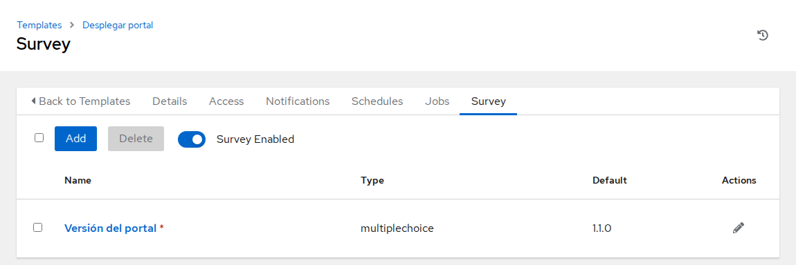

> [!NOTE]
> Sin encuesta, el mismo efecto se consigue con `portal_version: "1.1.0"` en el campo **Variables** de la
> plantilla y la casilla **Prompt on launch** marcada, para poder cambiarla al lanzar. La encuesta es más
> segura: no deja escribir una versión que no existe.

### 7 — Lanzar el despliegue y leer la salida

El botón **Launch** de la plantilla abre la encuesta; con `1.1.0` elegida, **Next** muestra el resumen y
**Launch** arranca el job. La página del job tiene dos pestañas:

- **Output**: la salida de `ansible-playbook` según se produce. Es la misma que en el terminal, porque es el
  mismo playbook. Empieza con `Identity added` (la clave de la credencial cargada en el agente SSH del job) y
  con avisos propios del execution environment, que lleva otra versión de ansible-core (2.18 al escribir
  esta página): una deprecación de `ANSIBLE_COLLECTIONS_PATHS` y el aviso del intérprete de Python de cada
  nodo. Después, lo conocido:

  ```text
  PLAY [Desplegar el portal 1.1.0] ***********************************************

  TASK [Gathering Facts] *********************************************************
  ok: [prod-web1]

  TASK [Leer la release actual] **************************************************
  ok: [prod-web1]

  TASK [Sacar el nodo del balanceador] *******************************************
  included: portal_lb for prod-web1 => (item=prod-lb1)

  TASK [portal_lb : Actualizar los servidores del balanceador] *******************
  changed: [prod-web1 -> prod-lb1]
  …
  TASK [Verificar que el portal responde] ****************************************
  ok: [prod-web1]
  …
  PLAY RECAP *********************************************************************
  prod-web1                  : ok=13   changed=8    unreachable=0    failed=0    skipped=0    rescued=0    ignored=0
  prod-web2                  : ok=13   changed=8    unreachable=0    failed=0    skipped=0    rescued=0    ignored=0
  ```

  Encima de la salida, un resumen con el número de plays, tareas y hosts, y el tiempo transcurrido:

  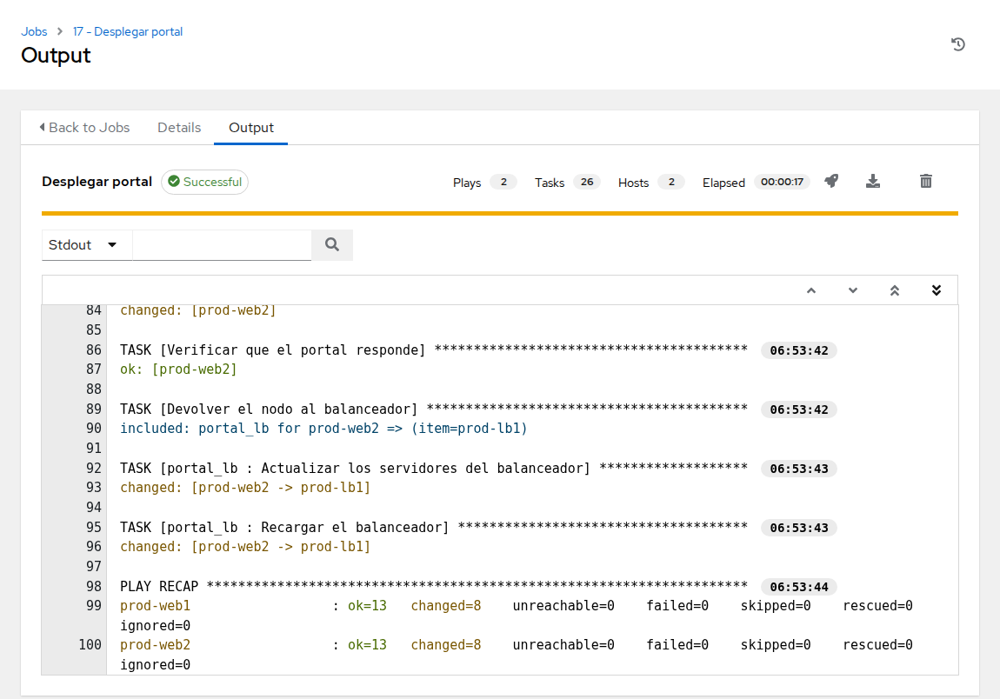

- **Details**: estado (**Successful**), quién lo lanzó (**Launched By** `admin`), plantilla, inventario,
  proyecto y **Revision** (el commit de `main` que se ejecutó), playbook, credencial, execution environment y
  las **Variables** con `portal_version: 1.1.0`.

Cada línea de la salida es un **evento** guardado en la base de datos de AWX. Al pulsar sobre una línea
como `changed: [prod-web1 -> prod-lb1]` se abre el detalle del host para esa tarea: módulo, resultado y el
JSON completo que devolvió, lo que en el terminal solo se ve con `-v`. Con el buscador de la salida se
filtra por host o por estado, por ejemplo para ver solo lo que cambió en `prod-web2`.

El resultado se comprueba igual que siempre, desde el terminal:

```bash
# Terminal del Codespace
curl -s localhost:8083/estado.json
```

```text
{
  "host": "prod-web1",
  "entorno": "prod",
  "version": "1.1.0",
  "color": "#15803d",
  "db": "prod-db1"
}
```

### 8 — Un despliegue que falla, visto desde AWX

Lanzada de nuevo con `1.2.0` (la release rota, sin `index.html`), la plantilla termina en **Failed**. La
salida cuenta lo mismo que contaría el terminal: el bloque `rescue` de `deploy.yml` vuelve a la release
anterior en `prod-web1`, el nodo vuelve al balanceador y `serial: 1` con `max_fail_percentage: 0` impide que
el despliegue llegue a `prod-web2`:

```text
TASK [Verificar que el portal responde] ****************************************
FAILED - RETRYING: [prod-web1]: Verificar que el portal responde (3 retries left).
…
fatal: [prod-web1]: FAILED! => {"attempts": 3, "changed": false, … "status": 403, …}

TASK [Volver a la release anterior] ********************************************
changed: [prod-web1]

TASK [Parar el despliegue] *****************************************************
fatal: [prod-web1]: FAILED! => {"changed": false, "msg": "La release 1.2.0 no responde en prod-web1; se ha vuelto a 1.1.0."}

TASK [Devolver el nodo al balanceador] *****************************************
included: portal_lb for prod-web1 => (item=prod-lb1)
…
PLAY RECAP *********************************************************************
prod-web1                  : ok=13   changed=9    unreachable=0    failed=1    skipped=0    rescued=1    ignored=0
```

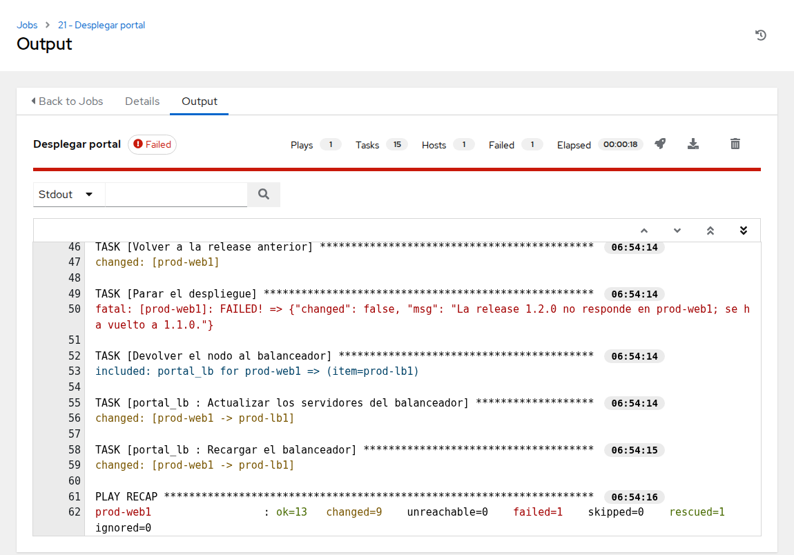

La diferencia con el terminal es que este fallo no se pierde al cerrar la pantalla: en **Views → Jobs**
quedan los dos despliegues, uno **Successful** y otro **Failed**, con su salida completa, la versión pedida y
el commit ejecutado. La lista incluye también los jobs de sincronización (**Source Control Update** del
proyecto e **Inventory Sync** del inventario) que lanzan las casillas **Update Revision on Launch** y
**Update on launch** antes de cada despliegue. `curl -s localhost:8083/estado.json` sigue diciendo
`"version": "1.1.0"`.

### 9 — Un equipo que puede lanzar, pero no cambiar

Se crea el equipo de guardia y una persona dentro:

1. **Access → Teams → Add**: **Name** `Operación portal`, **Organization** `Tienda Norte`.
2. **Access → Users → Add**: **Username** `guardia`, una contraseña, **User Type** `Normal User`,
   **Organization** `Tienda Norte`.
3. En el equipo `Operación portal`, pestaña **Access** → **Add**: el usuario `guardia` con el rol
   **Member**.
4. En la plantilla `Desplegar portal`, pestaña **Access** → **Add** → **Teams**: `Operación portal` con el
   rol **Execute**.

El permiso va al equipo, no a la persona: cuando cambie la guardia, basta con cambiar quién es miembro.

Al entrar como `guardia` (en una ventana privada del navegador, para no cerrar la sesión de `admin`), el
menú es el mismo, pero el contenido no:

| Lo que ve `guardia` | Por qué |
|---------------------|---------|
| En **Templates**, solo `Desplegar portal`, con el botón **Launch** | Tiene **Execute** sobre esa plantilla |
| Sin opción de editar la plantilla ni su encuesta | Execute no incluye **Admin** |
| En **Credentials**, nada | No tiene permiso sobre la credencial: la usa a través de la plantilla, pero no puede verla ni reutilizarla en otra |
| Puede lanzar y elegir versión en la encuesta | Es justo lo que se le ha concedido |

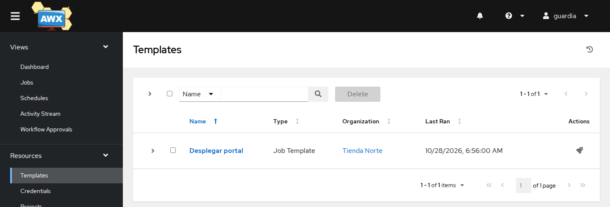

`guardia` lanza la plantilla con `1.0.0` y el job aparece en su lista de **Jobs** y en la de `admin`.

### 10 — Auditoría: quién lanzó qué y quién cambió qué

De vuelta como `admin`:

- **Views → Jobs**, buscando `Desplegar` por nombre, lista los tres despliegues. En el detalle de cada uno,
  **Launched By** dice `admin` o `guardia`, y **Variables** la versión que se pidió. Es la respuesta a
  «¿quién desplegó la 1.2.0 y qué pasó en `prod-web1`?».

  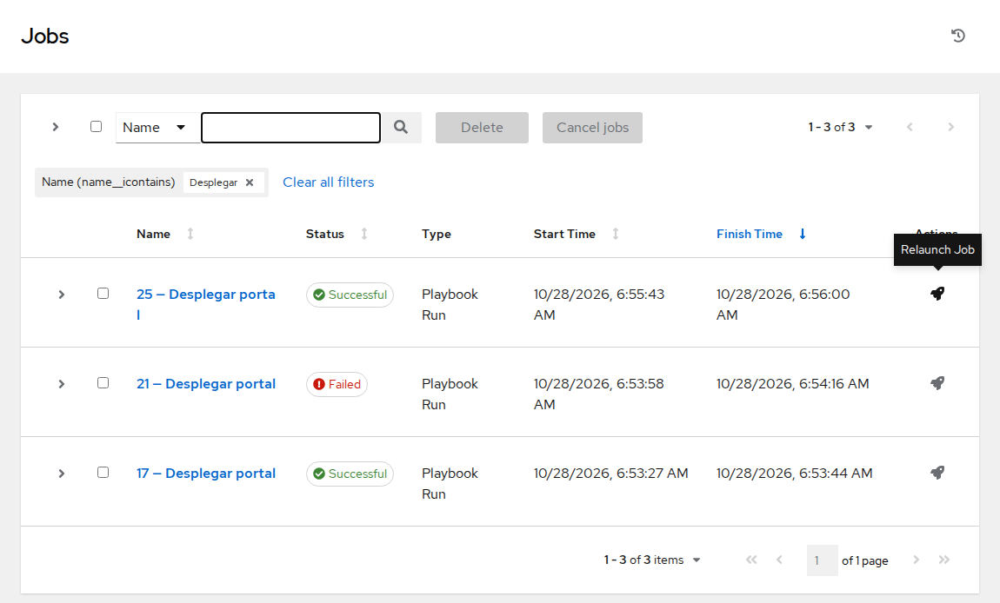

- **Views → Activity Stream** registra los cambios de configuración: quién creó la organización, el
  proyecto, la credencial y la plantilla, quién añadió la encuesta, quién metió a `guardia` en el equipo y
  quién dio a `Operación portal` el rol **Execute**, además de los jobs que lanzó cada usuario. Cada entrada
  tiene fecha, usuario que la inició (**Initiated by**) y, con la lupa, el detalle del cambio.

  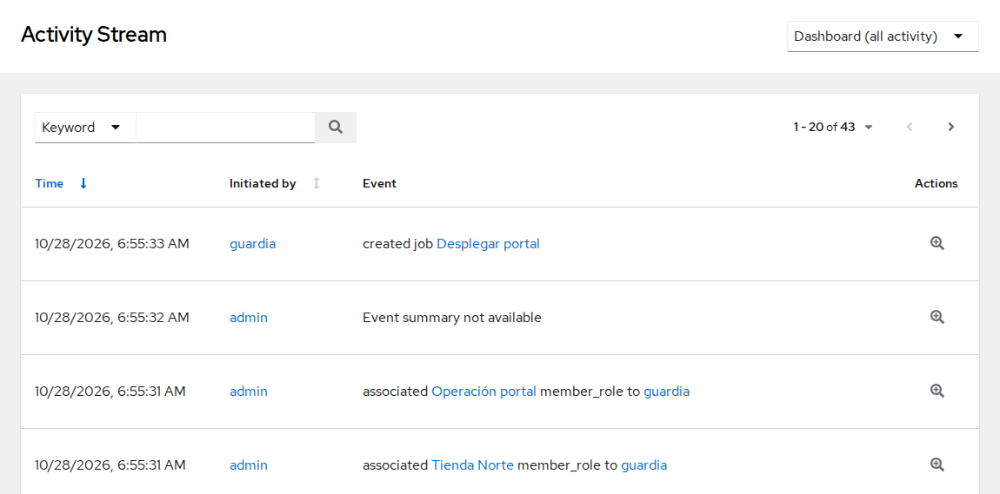

La misma información está en la API, lista para un informe o una herramienta de auditoría:

```bash
# Terminal del Codespace
curl -s -u "admin:$PASS" "$AWX/api/v2/jobs/?order_by=-id" \
  | python3 -c 'import json,sys
for j in json.load(sys.stdin)["results"]:
    print(j["id"], j["name"], j["status"], (j.get("launched_by") or {}).get("name"), j["extra_vars"])'
```

Cada línea muestra el número de job, la plantilla, el estado, quién lo lanzó y las variables extra.

## Problemas habituales

| Síntoma | Causa probable | Cómo arreglarlo |
|---------|----------------|-----------------|
| `scripts/awx-up.sh` dice `kind: command not found` | Se lanzó en el Codespace normal del curso | Crear el Codespace con la configuración **Ansible — Tienda Norte + AWX (demo M11)** |
| `scripts/awx-up.sh` se queda esperando y los pods de AWX siguen en `Pending` | Codespace con menos de 4 núcleos y 16 GB | Crear el Codespace de AWX con **New with options…** y esa configuración |
| La sincronización del proyecto falla | URL mal copiada, fork privado o rama inexistente | Revisar **Source Control URL** y **Branch**; el fork debe ser público |
| `proyecto/inventories/prod/hosts.yml` no aparece en **Inventory file** | AWX lo lista como playbook, no como inventario | Escribir la ruta y elegir **Set source path to "…"** |
| `proyecto/deploy.yml` no aparece en **Playbook** | `proyecto/` no está subido a la rama del proyecto, o el proyecto no se ha vuelto a sincronizar | `git push` y botón de sincronizar del proyecto |
| El job falla en `portal_lb` con `Destination directory /etc/nginx/sites-available does not exist` | Los nodos se recrearon después de `scripts/partida.sh m11` y están vacíos | Volver a lanzar `scripts/partida.sh m11` y relanzar la plantilla |
| El job termina con `UNREACHABLE` y `Could not resolve hostname` | El clúster no resuelve los nombres de los nodos (red o DNS de kind) | Volver a lanzar `scripts/awx-up.sh`: reconecta el nodo de kind a la red y revisa CoreDNS |
| El job termina con `Permission denied (publickey)` | La credencial no tiene la clave correcta o el usuario no es `ansible` | Revisar **Username** y volver a cargar la clave de `~/.ssh/curso-ansible/curso_ansible` |
| El job falla con `Host key verification failed` | La comprobación de claves de host está activa en AWX | Añadir `ANSIBLE_HOST_KEY_CHECKING: "False"` en las variables de entorno de los jobs (**Settings → Jobs settings → Extra Environment Variables**) |
| El login de AWX falla con `CSRF verification failed` | AWX se abrió desde un dominio que no es el suyo ni `https://*.app.github.dev`, el único que `infra/awx/awx.yaml` declara de confianza | Abrir AWX desde la pestaña **Puertos**, puerto 8043 |
| `site.yml` falla en `prod-db1` con `couldn't resolve module/action 'community.postgresql…'` | El execution environment por defecto (AWX EE) solo trae `ansible.posix` | Declararla en un `collections/requirements.yml` del proyecto o usar un EE que la incluya; `deploy.yml` no la necesita |

## Qué queda visto

El mismo `deploy.yml` del curso, lanzado desde AWX: el fork como **proyecto**, el `hosts.yml` de prod como
**inventario centralizado**, la clave como **credencial** que nadie ve, una **plantilla** con encuesta que
limita la versión, la **salida del job** con sus eventos por host, un equipo con permiso **Execute** y no
**Admin**, y la **auditoría** en Jobs y Activity Stream. Lo que AWX no ha cambiado es el playbook: rollback,
`serial` y verificación siguen siendo cosa de `deploy.yml`.

La alternativa sin controlador, lanzar Ansible desde un pipeline, se compara en
[CI/CD como alternativa](02-cicd-como-alternativa.md) y se practica en el
[M12 — Integración en entornos DevOps](../M12-integracion-devops/README.md).
