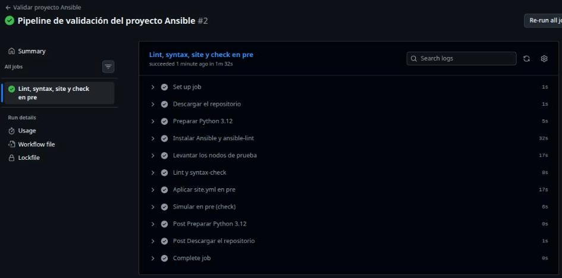
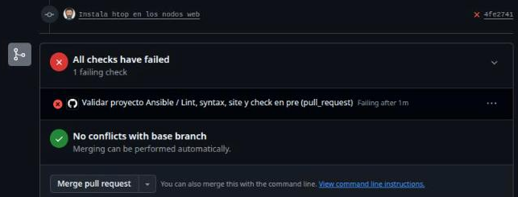
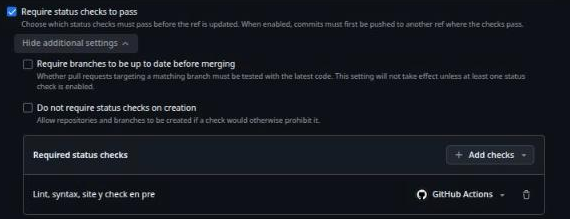
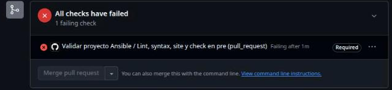

# Lab — Pipeline de validación

[← Página anterior](00-ansible-en-un-pipeline.md) · [Siguiente página →](02-lab-despliegue-desde-pipeline.md)

En Tienda Norte, los cambios del proyecto del portal ya llegan por pull request, pero la revisión depende de que
quien revisa se acuerde de lanzar `make validar` y `make check`. En este lab haces que lo lance GitHub Actions en
cada pull request: si `ansible-lint` o el modo check fallan, el pull request se pone en rojo antes de que nadie
lo fusione.

### Objetivo

Un workflow `.github/workflows/validar.yml` en tu fork que ejecuta lint, syntax-check, `site.yml` y modo check en
pre en cada pull request que toca `proyecto/`, visto en rojo con un fallo de lint y en verde tras corregirlo.

### Punto de partida

- Codespace abierto sobre **tu fork** del curso, con `gh` ya autenticado (Codespaces lo hace solo).
- Actions habilitado en el fork: en la pestaña **Actions** de tu fork en GitHub, si aparece el botón
  **I understand my workflows, go ahead and enable them**, púlsalo una vez.
- El paso 1 deja `proyecto/` en el estado `m12` (roles, `site.yml`, `deploy.yml`, `Makefile`, `.ansible-lint`) y
  los nodos recién creados, con prod instalado y pre vacío, como los encontrará el runner.
- No hace falta haber hecho la demostración ni ningún lab anterior.

### En qué consiste

Creas el workflow en una rama, ejecutas en el Codespace los mismos pasos que hará el runner (así lo pruebas sin
gastar ejecuciones), lo subes con un pull request y lo ves en verde. Después abres otro pull request con un error
de lint, lo ves en rojo, lo corriges y lo ves en verde. No tocas la configuración del repositorio: hacer
obligatorio el check queda para el reto.

### 1 — Prepara el punto de partida

**Acción** (terminal del Codespace, raíz del repo):

```bash
cd "$CODESPACE_VSCODE_FOLDER"
scripts/partida.sh m12 --limpio
```

**Por qué:** `--limpio` recrea los seis nodos y `m12` instala solo prod. Así pre queda vacío, igual que los
nodos que levantará el runner, y puedes reproducir el pipeline tal cual.

**Resultado esperado:** seis líneas `SSH ok`, el `PLAY RECAP` de prod con `failed=0` y al final
`Listo: proyecto/ en el punto de partida «m12»`.

### 2 — Haz que `gh` trabaje sobre tu fork

**Acción** (raíz del repo):

```bash
gh repo set-default "$GITHUB_REPOSITORY"
gh repo set-default --view
```

**Por qué:** en un fork, `gh pr create` propone por defecto abrir el pull request contra el repositorio original
del curso. Tus pull requests van contra el `main` de tu fork. `GITHUB_REPOSITORY` lo define Codespaces con
`<tu-usuario>/<repo>`.

**Resultado esperado:** `gh repo set-default --view` muestra `<tu-usuario>/<repo>`, no el repositorio original.

### 3 — Crea la rama del pipeline

**Acción:**

```bash
git switch main
git pull
git switch -c ci-validacion
```

**Por qué:** el workflow también es código del equipo: entra por rama y pull request, como cualquier otro cambio.

**Resultado esperado:** `Switched to a new branch 'ci-validacion'`.

### 4 — Escribe el workflow

**Acción:** crea `.github/workflows/validar.yml` en la **raíz** del repo (no en `proyecto/`) con este contenido:

```yaml
# .github/workflows/validar.yml
name: Validar proyecto Ansible

on:
  pull_request:
    branches: [main]
    paths:
      - "proyecto/**"
      - ".github/workflows/**"
  push:
    branches: [main]
    paths:
      - "proyecto/**"
      - ".github/workflows/**"

permissions:
  contents: read

jobs:
  validar:
    name: Lint, syntax, site y check en pre
    runs-on: ubuntu-24.04
    env:
      ANSIBLE_FORCE_COLOR: "1"
    steps:
      - name: Descargar el repositorio
        uses: actions/checkout@v7

      - name: Preparar Python 3.12
        uses: actions/setup-python@v7
        with:
          python-version: "3.12"
          cache: pip

      - name: Instalar Ansible y ansible-lint
        run: pip install -r requirements.txt

      - name: Levantar los nodos de prueba
        run: bash scripts/nodos.sh up

      - name: Lint y syntax-check
        working-directory: proyecto
        run: make validar

      - name: Aplicar site.yml en pre
        working-directory: proyecto
        run: make site ENTORNO=pre

      - name: Simular en pre (check)
        working-directory: proyecto
        run: make check ENTORNO=pre
```

**Por qué:**

- `pull_request` valida cada propuesta antes del merge; `push` a `main` vuelve a validar lo fusionado. No se usa
  `push` a todas las ramas: con un pull request abierto, cada push lanzaría dos ejecuciones iguales.
- `paths` evita lanzar Ansible por un cambio en `labs/` o en el README. Los cambios en `.github/workflows/` sí se
  validan: un workflow nuevo también entra por pull request y, si haces obligatorio el check (reto 1), necesita
  que el check llegue para poder fusionarse.
- El runner nace vacío: Python, `requirements.txt` y los nodos se preparan en cada ejecución.
- `make site ENTORNO=pre` va antes de `make check`: el modo check se usa sobre nodos instalados.

**Resultado esperado:** el fichero existe en `.github/workflows/validar.yml` y `git status` lo muestra como
`Untracked files`.

> [!TIP]
> Para comprobar que el YAML está bien formado antes de subirlo:
> `python3 -c 'import yaml; yaml.safe_load(open(".github/workflows/validar.yml")); print("YAML correcto")'`

### 5 — Simula el pipeline en el Codespace

**Acción** (terminal del Codespace, en `proyecto/`): ejecuta los tres pasos de Ansible del workflow, en orden.

```bash
cd proyecto
make validar
make site ENTORNO=pre
make check ENTORNO=pre
```

**Por qué:** es exactamente lo que hará el runner después de `scripts/nodos.sh up`. Si falla aquí, fallará en
Actions; arreglarlo ahora ahorra ida y vuelta.

**Resultado esperado:** `make validar` termina con
`Passed: 0 failure(s), 0 warning(s) in 18 files processed of 18 encountered. Profile 'production' was required, and it passed.`
El `site` sobre el pre recién creado instala todo y el `check` no cambia nada:

```text
PLAY RECAP *********************************************************************
pre-web1                   : ok=12   changed=11   unreachable=0    failed=0    skipped=0    rescued=0    ignored=0
…
PLAY RECAP *********************************************************************
pre-web1                   : ok=11   changed=0    unreachable=0    failed=0    skipped=0    rescued=0    ignored=0
```

### 6 — Sube la rama

**Acción:**

```bash
cd "$CODESPACE_VSCODE_FOLDER"
git add .github/workflows/validar.yml proyecto
git commit -m "Pipeline de validación del proyecto Ansible"
git push -u origin ci-validacion
```

**Por qué:** el workflow tiene que estar en el repositorio para que GitHub lo ejecute. `proyecto` entra en el
mismo commit por si el de tu `main` no está en el estado `m12`.

**Resultado esperado:** `git push` termina con `branch 'ci-validacion' set up to track 'origin/ci-validacion'`.

### 7 — Abre el pull request

**Acción:**

```bash
gh pr create --base main --head ci-validacion \
  --title "Pipeline de validación del proyecto Ansible" \
  --body "Lint, syntax-check, site y check en pre en cada pull request que toca proyecto/."
```

**Por qué:** el evento `pull_request` es el que dispara el workflow.

**Resultado esperado:** `gh` devuelve la URL del pull request en tu fork (`https://github.com/<tu-usuario>/<repo>/pull/N`).

### 8 — Sigue el check hasta el verde

**Acción:** en el Codespace, `gh pr checks --watch`. En el navegador, abre el pull request: al final de la pestaña
**Conversation** aparece el check; **Details** lleva a su log en **Actions**.

**Por qué:** es lo que verá quien revise: un check verde dice que el proyecto pasa lint y que `site.yml` se aplica
y es idempotente en pre, sin que nadie lo haya lanzado a mano.

**Resultado esperado:** el check **Lint, syntax, site y check en pre** pasa a verde (`pass`). En **Actions**, la
ejecución muestra los pasos en el orden del YAML; **Levantar los nodos de prueba** termina con las seis líneas
`SSH ok` y **Simular en pre (check)** con `changed=0`.



### 9 — Fusiona el pipeline

**Acción:**

```bash
gh pr merge ci-validacion --merge --delete-branch
git switch main
git pull
```

**Por qué:** desde ahora el workflow está en `main` y se aplica a cada pull request nuevo. El merge también
dispara el `push` a `main`, que vuelve a validar.

**Resultado esperado:** `gh` informa de que ha fusionado el pull request y borrado la rama; en **Actions** aparece
una ejecución nueva por el push a `main`.

### 10 — Propón un cambio con un error de lint

**Acción:** crea una rama y añade al final de `proyecto/roles/portal/tasks/main.yml` una tarea que instala `htop`
para diagnosticar los nodos web, escrita sin FQCN:

```bash
git switch -c diagnostico-htop
```

```yaml
# proyecto/roles/portal/tasks/main.yml (al final)

- name: Instalar herramientas de diagnóstico
  apt:
    name: htop
```

```bash
git add proyecto/roles/portal/tasks/main.yml
git commit -m "Instala htop en los nodos web"
git push -u origin diagnostico-htop
gh pr create --base main --head diagnostico-htop --title "Instala htop en los nodos web" --body "Para diagnosticar los nodos web."
```

**Por qué:** es un cambio razonable con un fallo típico, el que el pipeline está para parar antes del merge.

**Resultado esperado:** la URL del nuevo pull request.

### 11 — Mira el check en rojo

**Acción:** `gh pr checks --watch` y, cuando termine, `gh run view --log-failed` para ver solo el log del paso
que ha fallado. `gh run view` te enseña la lista de ejecuciones recientes: elige la de `diagnostico-htop`.

**Por qué:** un check rojo no basta; hay que saber leer **por qué**. El log es el mismo que darías en el terminal.

**Resultado esperado:** el check en rojo (`fail`). El paso **Lint y syntax-check** falla y los siguientes no se
ejecutan. El log termina así:

```text
# Rule Violation Summary

  1 fqcn profile:production tags:formatting

Failed: 1 failure(s), 0 warning(s) in 18 files processed of 18 encountered. Profile 'production' was required, but 'shared' profile passed. Rating: 4/5 star
fqcn[action-core]: Use FQCN for builtin module actions (apt).
roles/portal/tasks/main.yml:51:3 Use `ansible.builtin.apt` or `ansible.legacy.apt` instead.

make: *** [Makefile:18: lint] Error 2
```

En el pull request, el check aparece con una ✗ roja bajo **All checks have failed**. El botón **Merge pull request**
sigue activo: nada obliga todavía a que el check esté en verde (eso es el reto 1).



### 12 — Corrige y vuelve a verde

**Acción:** cambia `apt:` por `ansible.builtin.apt:` en la tarea nueva, compruébalo en local y sube el arreglo a la
misma rama:

```bash
cd proyecto
make validar
cd ..
git commit -am "Usa FQCN en la tarea de htop"
git push
gh pr checks --watch
```

**Por qué:** el arreglo entra en el mismo pull request; cada push a la rama vuelve a lanzar el workflow.

**Resultado esperado:** `make validar` local termina en `Passed`. En el pull request, el check vuelve a verde: esta
vez **Aplicar site.yml en pre** instala también `htop` (`TASK [portal : Instalar herramientas de diagnóstico]`
con `changed`) y **Simular en pre (check)** termina con `changed=0`.

### 13 — Cierra el pull request de prueba

**Acción:** `gh pr close diagnostico-htop --delete-branch` y después `git switch main`.

**Por qué:** el cambio servía para ver el pipeline en rojo y en verde; cerrándolo, `main` sigue igual que el estado
`m12` que usan los labs siguientes. Si quieres conservar `htop`, fusiónalo con `gh pr merge` en su lugar.

**Resultado esperado:** `gh` informa de que ha cerrado el pull request y borrado la rama.

## Comprueba tu entendimiento

**El workflow se dispara solo cuando toca**
Crea una rama, cambia una línea de `labs/M12-integracion-devops/README.md`, súbela y abre un pull request.
→ `gh pr checks` responde que no hay checks en esa rama: el cambio no toca `proyecto/` ni el workflow.

**El pipeline usa el Makefile**
Abre una ejecución verde en **Actions** y despliega **Lint y syntax-check**.
→ La primera línea del log es `ansible-lint site.yml deploy.yml`, la misma que imprime `make lint` en tu terminal.

**Por qué `site` antes de `check`**
En el Codespace, desde la raíz: `scripts/nodos.sh reset`, luego `cd proyecto && make check ENTORNO=dev`.
→ Falla en `TASK [portal : Instalar nginx]` con `No package matching 'nginx' is available`: en modo check no se
instala nada y el nodo está vacío.

## Reto

### 1 — Que el check sea obligatorio

Haz que no se pueda fusionar en `main` de tu fork ningún pull request cuyo check
**Lint, syntax, site y check en pre** no esté en verde. Pruébalo repitiendo los pasos 10 y 11.

<details>
<summary>Ver solución</summary>

En GitHub, en tu fork: **Settings → Rulesets → New ruleset → New branch ruleset**. Nombre `main protegida`,
**Enforcement status** `Active`, en **Target branches** pulsa **Add target → Include default branch** y marca
**Require status checks to pass**. Despliega **Show additional settings**, pulsa **Add checks** y añade
**Lint, syntax, site y check en pre** (aparece porque ya se ha ejecutado al menos una vez). Guarda con **Create**.



Con el pull request de htop sin FQCN, el check sale marcado como **Required** y **Merge pull request** queda
desactivado hasta que pase a verde:



Desde el terminal, `gh pr merge` responde `the base branch policy prohibits the merge`. Tú, como administrador del
fork, podrías saltártelo con `gh pr merge --admin`: en el repositorio del equipo, la persona que propone no lo es.

Ojo con `paths`: un pull request que solo toca `labs/` no lanza el workflow, y con el check obligatorio se queda
esperando un check que nunca llega. En la práctica se resuelve quitando `paths` del disparador `pull_request` o
con un job que siempre termina en verde cuando no hay cambios en `proyecto/`.

</details>

### 2 — Simular prod también

Amplía el workflow para que, además de pre, aplique y simule prod (balanceador, dos web y base de datos).
¿Qué tienes que añadir a la línea de `make` para que no se pare?

<details>
<summary>Ver solución</summary>

Dos pasos más al final:

```yaml
      - name: Aplicar site.yml en prod
        working-directory: proyecto
        run: make site ENTORNO=prod CONFIRMAR=si

      - name: Simular en prod (check)
        working-directory: proyecto
        run: make check ENTORNO=prod
```

`make site ENTORNO=prod` exige `CONFIRMAR=si` (sin él, el `Makefile` corta con `prod pide CONFIRMAR=si`). Aquí es
seguro porque los nodos de prod son los del runner, no los reales. Compruébalo antes en el Codespace con los
mismos dos comandos: el `PLAY RECAP` del check tiene `changed=0` en los cuatro nodos de prod.

</details>

## Errores frecuentes

| Síntoma | Causa probable | Cómo arreglarlo |
|---------|----------------|-----------------|
| El pull request no muestra ningún check | El workflow está en `proyecto/.github/workflows/` y no en la raíz, o Actions no está habilitado en el fork | Mueve el fichero a `.github/workflows/` de la raíz; en la pestaña **Actions** pulsa **I understand my workflows, go ahead and enable them** |
| `gh pr create` abre el pull request contra el repositorio original del curso | `gh` usa por defecto el repositorio padre del fork | `gh repo set-default "$GITHUB_REPOSITORY"` y repite con `--base main` |
| El paso **Lint y syntax-check** falla con `make: *** No rule to make target 'validar'` | Falta `working-directory: proyecto`, o `proyecto/` en esa rama no tiene el `Makefile` | Añade `working-directory: proyecto` al paso; carga `scripts/partida.sh m12` y súbelo |
| **Simular en pre (check)** falla con `No package matching 'nginx' is available` | El check se lanza sobre un nodo vacío: falta el paso de `make site ENTORNO=pre` o va después | Pon **Aplicar site.yml en pre** antes del check |
| `Invalid workflow file` en **Actions** | YAML mal indentado (tabuladores, `steps` fuera de `jobs.validar`) | Valida con `python3 -c 'import yaml; yaml.safe_load(open(".github/workflows/validar.yml"))'` y corrige la línea que indique |
| **Levantar los nodos de prueba** se queda en `SIN SSH` en algún nodo | El nodo no ha arrancado a tiempo en el runner | Vuelve a lanzar la ejecución con **Re-run jobs**; si se repite, mira el log de `docker compose` en ese mismo paso |
