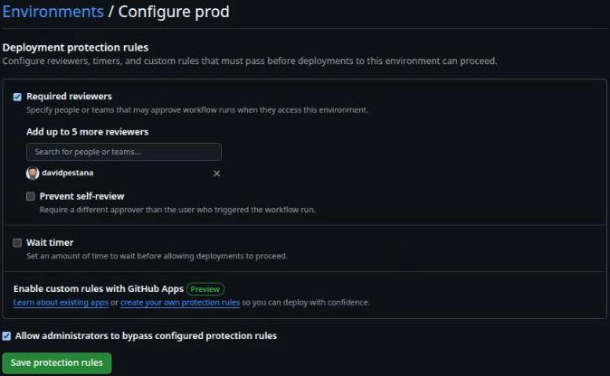
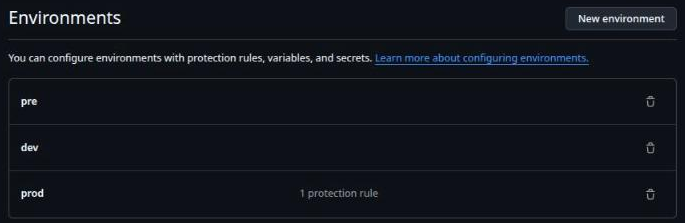
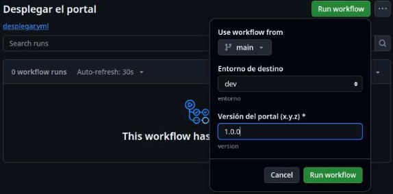
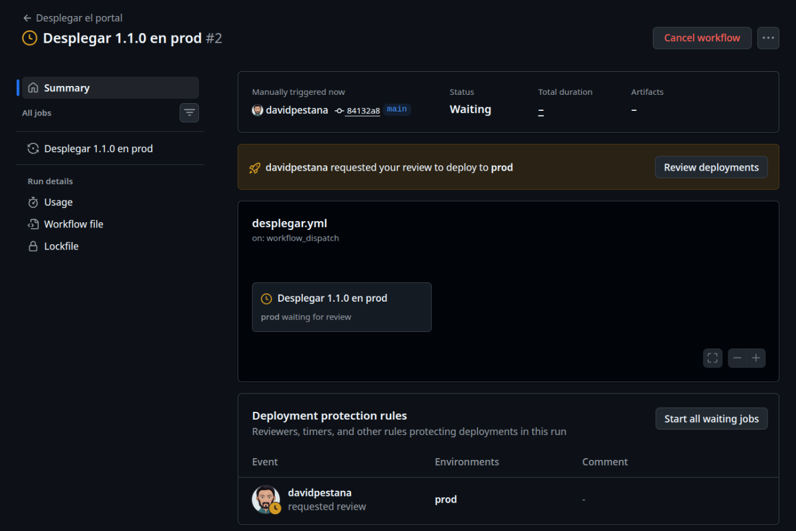
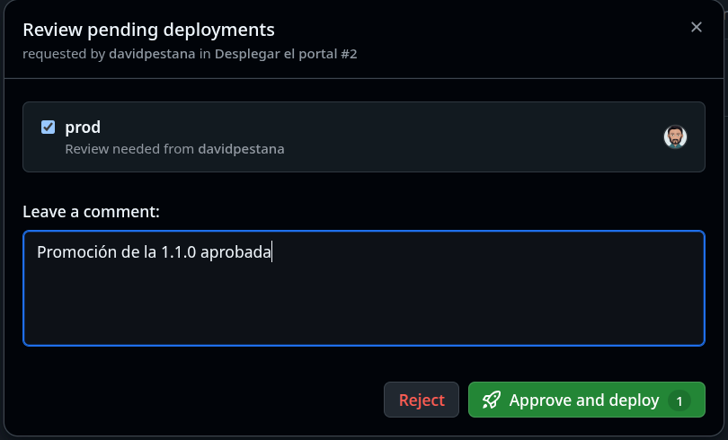

# Lab — Despliegue desde pipeline

[← Página anterior](01-lab-pipeline-de-validacion.md) · [Siguiente página →](03-lab-flujo-gitops.md)

En Tienda Norte, desplegar una versión del portal es `make deploy ENTORNO=prod VERSION=… CONFIRMAR=si` lanzado por
quien tenga acceso a prod, y el único registro es su terminal. En este lab el despliegue pasa a ser un botón:
un workflow manual en GitHub Actions donde eliges entorno y versión, que en prod espera a que alguien lo apruebe y
que deja en **Actions** quién lo lanzó, quién lo aprobó y el log completo.

### Objetivo

Un workflow `.github/workflows/desplegar.yml` que se lanza con **Run workflow**, despliega la versión elegida en
dev, pre o prod con `make deploy`, se para a pedir aprobación antes de prod y verifica el portal con `curl`.

### Punto de partida

- Codespace abierto sobre **tu fork**, con Actions habilitado (pestaña **Actions** → **I understand my workflows,
  go ahead and enable them**, si aparece).
- El paso 1 deja `proyecto/` en el estado `m12` y prod instalado en los nodos del Codespace con la 1.0.0.
- Versiones del portal en `proyecto/app/releases/`: `1.0.0`, `1.1.0` y `1.2.0` (esta, rota a propósito: sin
  `index.html`, nginx responde 403).
- No hace falta haber hecho los labs anteriores; si ya tienes `validar.yml`, convive con este sin problema.

### En qué consiste

Creas los entornos de GitHub (`dev`, `pre`, `prod`, con revisor obligatorio en prod), escribes el workflow, lo
pruebas en el Codespace con los mismos comandos y lo lanzas desde **Actions** dos veces: a dev sin aprobación y
a prod con ella.

> [!IMPORTANT]
> **Esto es una simulación.** El runner no llega a los nodos de tu Codespace: levanta sus propios seis nodos,
> vacíos, instala el entorno elegido con `make site` y despliega sobre ellos. El portal que verifica el último
> paso es el del runner. Con servidores reales, el runner llegaría a ellos por SSH (normalmente un runner
> *self-hosted* en la red de la empresa y la clave como secreto del entorno) y el paso `make site` previo sobraría.

### 1 — Prepara el punto de partida

**Acción** (terminal del Codespace, raíz del repo):

```bash
cd "$CODESPACE_VSCODE_FOLDER"
scripts/partida.sh m12
gh repo set-default "$GITHUB_REPOSITORY"
```

**Por qué:** `m12` trae el `Makefile` con `make deploy` y el `deploy.yml` escalonado con vuelta atrás. `gh repo
set-default` hace que `gh` trabaje sobre tu fork y no sobre el repositorio original.

**Resultado esperado:** el `PLAY RECAP` de prod con `failed=0`, `Listo: proyecto/ en el punto de partida «m12»` y
`gh repo set-default --view` mostrando `<tu-usuario>/<repo>`.

### 2 — Crea el entorno `prod` con revisor obligatorio

**Acción** (GitHub, en tu fork):

1. Abre **Settings → Environments** y pulsa **New environment**.
2. En **Name** escribe `prod` y pulsa **Configure environment**.
3. Marca **Required reviewers** y añádete a ti mismo en el buscador. Deja **Prevent self-review** sin marcar: en tu
   fork eres a la vez quien lanza y quien aprueba.
4. Pulsa **Save protection rules**.

**Por qué:** un job con `environment: prod` no empieza hasta que uno de los revisores lo aprueba. Es la versión
de plataforma del `CONFIRMAR=si`: en vez de escribirlo quien ejecuta, lo da otra persona, y queda registrado.

**Resultado esperado:** `prod` aparece en **Settings → Environments** con `1 protection rule`. Al abrirlo, tu
usuario figura bajo **Required reviewers**:



### 3 — Crea `dev` y `pre` sin reglas

**Acción:** repite **New environment** con `dev` y con `pre`, y en cada uno pulsa **Save protection rules** sin
marcar nada.

**Por qué:** el workflow usa `environment: ${{ inputs.entorno }}`. Si el entorno no existe, GitHub lo crea solo
en la primera ejecución, sin reglas; creándolos tú, los tres quedan a la vista y es fácil añadir reglas a pre más
adelante.

**Resultado esperado:** en **Settings → Environments** hay tres entornos: `dev`, `pre` y `prod` (solo este con regla).



### 4 — Escribe el workflow

**Acción:** en una rama nueva (`git switch main && git pull && git switch -c ci-desplegar`), crea
`.github/workflows/desplegar.yml` en la raíz del repo:

```yaml
# .github/workflows/desplegar.yml
name: Desplegar el portal
run-name: Desplegar ${{ inputs.version }} en ${{ inputs.entorno }}

on:
  workflow_dispatch:
    inputs:
      entorno:
        description: Entorno de destino
        type: choice
        options: [dev, pre, prod]
        default: dev
      version:
        description: Versión del portal (x.y.z)
        type: string
        required: true
        default: "1.1.0"

permissions:
  contents: read

concurrency:
  group: desplegar-${{ inputs.entorno }}
  cancel-in-progress: false

jobs:
  desplegar:
    name: Desplegar ${{ inputs.version }} en ${{ inputs.entorno }}
    runs-on: ubuntu-24.04
    environment: ${{ inputs.entorno }}
    env:
      ANSIBLE_FORCE_COLOR: "1"
      ENTORNO: ${{ inputs.entorno }}
      VERSION: ${{ inputs.version }}
    steps:
      - name: Descargar el repositorio
        uses: actions/checkout@v7

      - name: Preparar Python 3.12
        uses: actions/setup-python@v7
        with:
          python-version: "3.12"
          cache: pip

      - name: Instalar Ansible y ansible-lint
        run: pip install -r requirements.txt

      - name: Levantar los nodos del runner
        run: bash scripts/nodos.sh up

      - name: Instalar el entorno (los nodos del runner nacen vacíos)
        working-directory: proyecto
        run: make site ENTORNO="$ENTORNO" CONFIRMAR=si

      - name: Desplegar la versión
        working-directory: proyecto
        run: make deploy ENTORNO="$ENTORNO" VERSION="$VERSION" CONFIRMAR=si

      - name: Verificar el portal
        run: |
          case "$ENTORNO" in
            dev) PUERTO=8081 ;;
            pre) PUERTO=8082 ;;
            prod) PUERTO=8080 ;;
          esac
          curl -s "localhost:$PUERTO/estado.json"
          curl -s "localhost:$PUERTO/estado.json" | grep -q "\"version\": \"$VERSION\""
```

**Por qué:**

- `workflow_dispatch` con `inputs` dibuja un formulario en **Run workflow**: `entorno` es un desplegable con tres
  valores fijos, así nadie despliega en `pord`.
- `run-name` pone a cada ejecución un título con la versión y el entorno: en **Actions** se distingue qué se
  desplegó dónde sin abrir cada ejecución.
- `environment` toma el entorno elegido; en `prod`, el job espera aprobación antes del primer paso.
- `CONFIRMAR=si` va siempre: la confirmación ya la ha dado el revisor del entorno.
- `make site` antes de `make deploy`: `make deploy` ejecuta antes `make check`, y en los nodos vacíos del runner el
  check falla (ver **Errores frecuentes**).
- Las entradas llegan al script como variables de entorno (`$ENTORNO`, `$VERSION`) y no pegadas con `${{ … }}`
  dentro de `run`: así un valor raro en **version** no se ejecuta como código.
- `concurrency` impide dos despliegues a la vez sobre el mismo entorno: el segundo espera a que acabe el primero.
- El último paso falla si `estado.json` no dice la versión pedida.

**Resultado esperado:** `python3 -c 'import yaml; yaml.safe_load(open(".github/workflows/desplegar.yml")); print("YAML correcto")'`
imprime `YAML correcto`.

### 5 — Prueba los pasos en el Codespace

**Acción** (en `proyecto/`): lanza lo mismo que hará el job con `entorno=prod` y `version=1.1.0`.

```bash
cd proyecto
make site ENTORNO=prod CONFIRMAR=si
make deploy ENTORNO=prod VERSION=1.1.0 CONFIRMAR=si
curl -s localhost:8080/estado.json
```

**Por qué:** comprobar en local lo que va a ejecutar el pipeline te ahorra ejecuciones en rojo. En el Codespace
prod ya está instalado, así que `make site` no cambia nada; en el runner instalará todo.

**Resultado esperado:** el `deploy` actualiza las dos web de una en una, sacándolas y devolviéndolas al balanceador:

```text
TASK [portal_lb : Recargar el balanceador] *************************************
changed: [prod-web2 -> prod-lb1]

PLAY RECAP *********************************************************************
prod-web1                  : ok=13   changed=8    unreachable=0    failed=0    skipped=0    rescued=0    ignored=0
prod-web2                  : ok=13   changed=8    unreachable=0    failed=0    skipped=0    rescued=0    ignored=0
```

Y el portal, a través del balanceador, ya sirve la 1.1.0:

```text
{
  "host": "prod-web1",
  "entorno": "prod",
  "version": "1.1.0",
  "color": "#15803d",
  "db": "prod-db1"
}
```

### 6 — Devuelve prod del Codespace a lo que dice Git

**Acción:** `make site ENTORNO=prod CONFIRMAR=si` y `curl -s localhost:8080/estado.json`.

**Por qué:** `inventories/prod/group_vars/all.yml` dice `portal_version: "1.0.0"`. `make deploy` cambió los nodos
pero no Git, y `make site` aplica lo que dice Git. Es justo la tensión que resuelve el [flujo GitOps](03-lab-flujo-gitops.md).

**Resultado esperado:** el `PLAY RECAP` con `changed=1` en `prod-web1` y `prod-web2` (el enlace `current` vuelve a
la 1.0.0) y `"version": "1.0.0"` en el `curl`.

### 7 — Sube el workflow a `main`

**Acción** (raíz del repo):

```bash
cd "$CODESPACE_VSCODE_FOLDER"
git add .github/workflows/desplegar.yml proyecto
git commit -m "Workflow manual de despliegue del portal"
git push -u origin ci-desplegar
gh pr create --base main --head ci-desplegar --title "Workflow manual de despliegue" --body "Run workflow con entorno y versión; prod con aprobación."
gh pr merge ci-desplegar --merge --delete-branch
git switch main
git pull
```

**Por qué:** un workflow con `workflow_dispatch` solo muestra **Run workflow** cuando el fichero está en la rama
por defecto.

**Resultado esperado:** en la pestaña **Actions**, la lista de la izquierda incluye **Desplegar el portal**.

> [!NOTE]
> Si hiciste el reto 1 del [Lab — Pipeline de validación](01-lab-pipeline-de-validacion.md) (check obligatorio en
> `main`), `gh pr merge` justo después de crear el pull request responde `Repository rule violations found`:
> espera antes al check con `gh pr checks --watch` y repite el merge.

### 8 — Despliega en dev

**Acción** (GitHub): **Actions → Desplegar el portal → Run workflow**. Deja **Use workflow from** en `main`, elige
**Entorno de destino** `dev`, escribe `1.0.0` en **Versión del portal (x.y.z)** y pulsa **Run workflow**.



> [!NOTE]
> `gh workflow run desplegar.yml …` desde el terminal del Codespace responde `HTTP 403: Resource not accessible by
> integration`: el token que Codespaces da a `gh` puede subir código y abrir pull requests, pero no lanzar
> workflows. Lánzalos desde **Run workflow**; para seguirlos desde el terminal, `gh run watch` sí funciona.

**Por qué:** dev no tiene reglas: el job arranca enseguida. La 1.0.0 no es la de los `group_vars` de dev (1.1.0),
así que el despliegue cambia algo de verdad.

**Resultado esperado:** la ejecución aparece en **Actions** con el título **Desplegar 1.0.0 en dev** y termina en
verde. En el paso **Verificar el portal**, el log muestra el `estado.json` con `"entorno": "dev"` y
`"version": "1.0.0"`. Con `gh run watch` (eliges la ejecución en la lista) la sigues desde el terminal.

### 9 — Despliega en prod y apruébalo

**Acción:**

1. **Run workflow** otra vez, con **Entorno de destino** `prod` y versión `1.1.0`.
2. Abre la ejecución: el job queda en espera con el aviso de que necesita revisión para `prod`.

   

3. Pulsa **Review deployments**, marca `prod`, escribe un comentario (`Promoción de la 1.1.0 aprobada`) y pulsa
   **Approve and deploy**.

   

El botón **Start all waiting jobs** de **Deployment protection rules** también arranca el job, pero saltándose la
revisión: aparece porque eres administrador del fork (opción **Allow administrators to bypass configured
protection rules** del entorno). No lo uses: la gracia es que quede la aprobación.

**Por qué:** es la separación de funciones que pide un cambio en producción: quien lanza no es necesariamente quien
aprueba, y las dos cosas quedan en el historial de la ejecución.

**Resultado esperado:** antes de aprobar no se ha ejecutado ningún paso. Tras aprobar, el job corre: **Desplegar la
versión** muestra el `PLAY RECAP` con `prod-web1` y `prod-web2` en `failed=0`, y **Verificar el portal** imprime el
`estado.json` del balanceador con `"version": "1.1.0"`. En **Settings → Environments → prod** (o en la sección
**Deployments** de la página del repo) queda el despliegue con su fecha y quién lo aprobó.

## Comprueba tu entendimiento

**El formulario no deja inventar entornos**
**Actions → Desplegar el portal → Run workflow** y despliega **Entorno de destino**.
→ Solo ofrece `dev`, `pre` y `prod`.

**Sin aprobación no hay despliegue**
Lanza un despliegue a `prod` y no lo apruebes.
→ El job sigue en espera y ningún paso tiene log. Desde la ejecución puedes cancelarlo con **Cancel workflow**.

**Una versión que no existe no llega al portal**
Lanza **Run workflow** con **Entorno de destino** `pre` y versión `1.0.1`.
→ El job falla en **Desplegar la versión**: no existe `app/releases/1.0.1`, la copia falla con
`Could not find or access '…/app/releases/1.0.1/' on the Ansible Controller`, el `rescue` deja la release anterior
y **Verificar el portal** no llega a ejecutarse.

## Reto

### 1 — Desplegar la versión rota

Lanza el despliegue de la `1.2.0` en `prod`. Antes de mirar el log, decide: ¿en qué paso se pondrá rojo el job, y
qué versión servirá el portal del runner al final?

<details>
<summary>Ver solución</summary>

**Run workflow** con `prod` y `1.2.0`, y aprueba en **Review deployments**.

Falla **Desplegar la versión**. En el log, `prod-web1` no pasa **Verificar que el portal responde** (403), el
`rescue` vuelve a la release anterior y el `always` lo devuelve al balanceador. Con `serial: 1` y
`max_fail_percentage: 0`, `prod-web2` ni se toca. Se reproduce en el Codespace con
`make deploy ENTORNO=dev VERSION=1.2.0`:

```text
fatal: [dev-web1]: FAILED! => {"changed": false, "msg": "La release 1.2.0 no responde en dev-web1; se ha vuelto a 1.1.0."}
…
dev-web1                   : ok=7    changed=5    unreachable=0    failed=1    skipped=2    rescued=1    ignored=0
```

**Verificar el portal** no llega a ejecutarse: un paso fallido para el job. El portal del runner sigue en la
versión que tenía antes del despliegue (en prod, la 1.0.0 que instaló `make site`).

</details>

### 2 — Pre también con aprobación, pero sin esperar a nadie de fuera

Haz que pre pida aprobación pero que la puedas dar tú, y que prod no se pueda desplegar desde otra rama que no sea `main`.

<details>
<summary>Ver solución</summary>

En **Settings → Environments → pre**, marca **Required reviewers** y añádete. En **prod**, en
**Deployment branches and tags**, elige **Selected branches and tags** y añade la regla `main`. Un **Run workflow**
con **Use workflow from** en otra rama queda rechazado para prod con un aviso de que la rama no puede desplegar en
ese entorno.

</details>

## Errores frecuentes

| Síntoma | Causa probable | Cómo arreglarlo |
|---------|----------------|-----------------|
| `gh workflow run` responde `HTTP 403: Resource not accessible by integration` | El token de `gh` en Codespaces no puede lanzar workflows | Lánzalo desde **Actions → Desplegar el portal → Run workflow** |
| En **Actions** no aparece el botón **Run workflow** | `desplegar.yml` no está en `main` (la rama por defecto) | Fusiona el pull request del paso 7 |
| **Desplegar la versión** falla en `make check` con `No package matching 'postgresql' is available` | Falta el paso `make site` antes: `make deploy` ejecuta `validar` y `check`, y el check falla en nodos vacíos | Añade **Instalar el entorno** antes de **Desplegar la versión** |
| `prod pide CONFIRMAR=si` y `Error 2` | Falta `CONFIRMAR=si` en la línea de `make` | Añádelo: la confirmación la da el revisor del entorno |
| El job de prod arranca sin pedir aprobación | El entorno se llama distinto (`Prod`, `produccion`) o no tiene **Required reviewers** | El nombre del entorno en **Settings → Environments** tiene que ser exactamente el valor del input: `prod` |
| **Verificar el portal** falla con la versión correcta en el log de Ansible | El `grep` no coincide: espacios o comillas distintos en el patrón | El patrón es `"version": "x.y.z"`, con un espacio tras los dos puntos, como en `templates/estado.json.j2` |
| Tras el despliegue, un `make site` vuelve a la versión anterior | La versión desplegada no está en `group_vars`: `site` aplica lo que dice Git | Si la versión debe quedarse, cámbiala en `inventories/<entorno>/group_vars/all.yml` por pull request |
